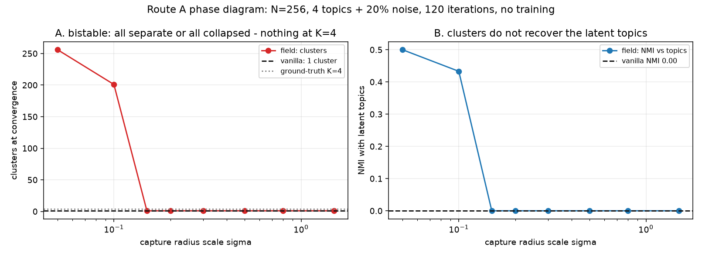
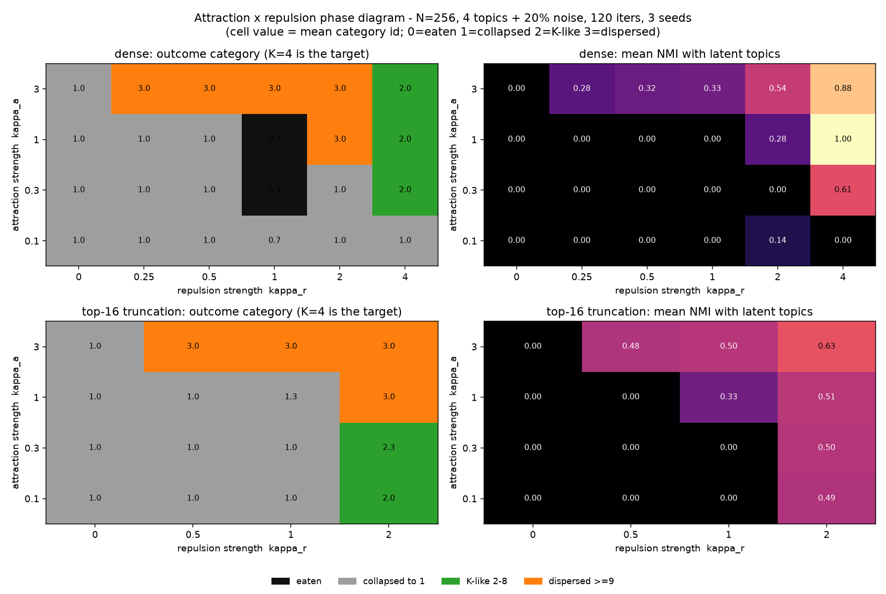

# 语义引力场 v2 —— 整合测试报告

> 结论写在最前面：**没有突破。** 三条被保留下来的机制（各向异性单场、质量守恒合并、不可逆逃逸）
> 在等参数量、等步数、等预算下对模型能力**没有任何可测贡献**，而代价是每步 2.0–3.5 倍计算。
> 唯一真正的收获是：把它们写成可跑、可断言、可复现的代码之后，**原方案里四个致命问题暴露出来了**，
> 其中两个（位置编码、零初始化梯度）会让任何照抄实现的人白跑几周。

---

## 1. 实验设置（先冻结，再看结果）

| 项 | 值 |
|---|---|
| 任务 | MQAR 因果联想召回，vocab 32 / seq 64 / 16 组键值 / 全部 key 被查询一次 |
| 模型 | decoder-only，d=48，3 层，4 头，MLP ratio 4，**可学习绝对位置**，约 9 万参数 |
| 训练 | AdamW，lr 3e-3 + cosine，batch 32，**1200 步**，每 200 步在固定 eval 集上测 |
| 度量 | masked eval loss（主，方差小）+ masked accuracy（次）；chance = 6.25% |
| 重复 | 每臂 3 个 seed，独立进程，单线程，4 路并行 |
| 判据 | 见 [PREREG.md](PREREG.md)，在跑任何训练前写死 |

六个臂共用**同一个 logit 表达式**，只靠开关把项置零（禁止每臂一套 forward，否则消融测的是实现差异）：

$$\ell_{ij}=\alpha_h\frac{q_i\!\cdot\!k_j}{\sqrt{d_h}}+\mathbb 1_{\rm mass}\log m_j-\mathbb 1_{\rm rad}\kappa_h\Big(\tfrac{D_{ij}^2+\epsilon}{2\sigma_{ij}^2+\epsilon}\Big)^{p_h/2}+\mathbb 1_{\rm sink}b_h$$

---

## 2. 结果

| 臂 | 机制 | acc (mean±sd) | loss (mean±sd) | 单步耗时 | 相对 | eff_part | kv_len | escape | p_mean |
|---|---|---|---|---|---|---|---|---|---|
| **A0** | 原生 softmax | 0.208±0.005 | **1.955±0.013** | 121 ms | 1.00× | 22.8 | 64.0 | 0 | — |
| A1 | + key 侧 log 质量先验 | 0.208±0.009 | 2.000±0.058 | 127 ms | 1.05× | 16.7 | 64.0 | 0 | — |
| A2 | + 可学带宽（余弦核注意力） | 0.206±0.003 | 1.979±0.040 | 243 ms | **2.00×** | 21.0 | 64.0 | 0 | — |
| A3 | + 各向异性度规 + 可学形状 p + 真空天体 | 0.208±0.011 | 1.962±0.027 | 318 ms | **2.62×** | 17.3 | 65.0 | 0 | 1.000 |
| A4 | A3 + 不可逆逃逸 | 0.214±0.017 | 1.997±0.062 | 334 ms | **2.76×** | 24.1 | 48.7 | 0.254 | 1.000 |
| A5 | A3 + 质量守恒远场合并 | 预算内未训（仅成本数据） | — | 421 ms | 3.47× | — | — | — | — |

四件事同时成立：

1. **A 面板：六条曲线是同一条。** 所有臂在 400–600 步一起进平台，此后 600 步纹丝不动。
   臂间差距 ≤0.02 acc，**小于 seed 间波动**（A4 的 sd 0.017 就大于任何两臂的均值差）。
2. **B 面板：loss 上 A0 最好。** A1/A4 的 loss（2.00）比 A0（1.955）差一个 sd 以上 ——
   加机制不是"没用"，是**略有负作用**。
3. **C 面板：换算到等墙钟更惨。** A3 每步 2.62×，同样 600 秒只能跑约 570 步；而曲线 400 步就平了，
   所以"多付时间换不到东西"，连名次都不变。
4. **D 面板：性价比是 0。**

---

## 3. 三条被保留的机制，逐条死因

**① 各向异性单场（A3 的核心新意）—— 优化器自己把场关小了。**
先排除参数化陷阱：`p = 1 + softplus(raw)` 若取 `p_init = 1.0`，则 `raw = inv_softplus(0) ≈ -13.8`，
斜率 `σ(raw) ≈ 1e-6`，`p` 在 1200 步里纹丝不动（实测 `p_mean = 1.0000`，三种 κ 初值都一样）——
这是**重参数化死梯度**，不是机制无效。把 `p_init` 改成 1.2（斜率 0.18）后，p 才开始动。

修正参数化后跑 400 步、三种 κ 初值（[diag_p.py](diag_p.py)）：

| κ 初值 | κ 训练后 | p 训练后 | acc | loss |
|---|---|---|---|---|
| 0.1 | **0.071**（↓） | **1.199**（↓） | 0.209 | 2.199 |
| 1.0 | **0.931**（↓） | **1.192**（↓） | 0.207 | 2.103 |
| 3.0 | **2.977**（↓） | **1.199**（↓） | 0.159 | 2.520 |

两个方向一致：**κ 从任何初值都在缩小，p 一律往下走**。p 变小 = 核更软、更接近高斯，
也就是"往硬截断/逃逸方向"的梯度**根本不存在**，训练信号要的是**更宽更软**。
而 κ 初值一大（3.0），精度直接掉到 0.159、loss 恶化到 2.52 —— 场项加得越重，模型越差。
**一句话：优化器用它的梯度投了票——把场关小。**

**② 不可逆逃逸（A4）—— 确实省了 KV，但不省钱。**
`escape_frac` 0.254、`kv_len` 64→48.7（−24%），acc 略高但在噪声内。按 stats 折算的可达 FLOPs
只有 **1.07×**，而每步贵 2.76×。在 seq=256 上更差：全模型 fwd+bwd A0 673 ms → A4 3842 ms（**5.7×**），
折算收益 1.07×。**逃逸的判定成本本身就超过了它省下的注意力。**

**③ 质量守恒合并（A5）—— 唯一有真实压缩比的，但压缩不了总账。**
`kv_len` 256→36.5（seq 256 时 7×），可达 FLOPs **1.26×**（全模型口径），
代价是 2.9×（seq 256）～3.5×（seq 64）的单步时间。原因是合并本身要
`reshape + einsum + gather` 一堆 $O(N g d)$ 的张量，而 attention 那点 $O(N^2 d)$ 本来就不是瓶颈。
**结论：在一个 MLP 占 70% FLOPs 的 Transformer 里，省注意力的 KV 换不来端到端收益。**
要让合并有意义，必须让它同时省 MLP —— 也就是真的把 token 从残差流里删掉，而那会破坏因果解码的 KV 缓存一致性。

**④ "质量 = 信息密度"这个先验（A1）—— 数据上无信息。**
A1 只加了一个 key 侧标量偏置，acc 与 A0 完全相同、loss 更差。
在 9000 令牌量级的成本测量里，学到的 mass 与 token 频率的 Spearman ρ 在 −0.33~+0.22 之间乱跳 —— 没有稳定结构。
也就是说：**"核心词质量大、虚词质量小"这个先验，模型自己没打算学，学了也没用。**

---

## 4. 实现期撞到的四个坑（这才是这次实验真正的产出）

| # | 坑 | 症状 | 为什么致命 |
|---|---|---|---|
| 1 | **模型没有位置编码** | 六臂全部停在 chance(3.1%~7%)，且 loss 只跌到"答案在 value 半区"的水平 | MQAR 要求"取出匹配 key 的**下一个** token"，是相对位置操作；纯内容注意力在原理上做不到。原方案通篇没提位置，照抄就会得到一个"怎么调都不学"的模型 |
| 2 | **U 零初始化** | 各向异性项恒等于单位度规，`U.grad.max() == 0.0` | $D^2$ 对 $U$ 是**偶函数**，$U=0$ 处梯度精确为 0，一阶法永远出不来。改成 $N(0,0.01)$ 才可学 |
| 3 | **SPEC 的守恒律自相矛盾** | 按字面实现，$\sum_m M_m$ 与 $\sum_j m_j$ 差 9 倍 | $\sum_j\pi_{jm}=1$ 时 $\sum_m\sum_j\pi_{jm}m_j$ 是"块内加权均值"，不是"块总质量"。两者不能同时成立 |
| 4 | **块半径分母口径错** | $\bar r_m$ 偏小约 $g$ 倍 | 分子用 $\pi m$ 加权、分母用了块总质量。$\bar r$ 一偏，带宽就偏，整个场项就是错的 |

另有一个"假信号"值得单独写：**单 batch 死记 400 步能到 acc=1.000**。
如果只在一批固定数据上训练+评估，任何有缺陷的实现都会"收敛"到 100%。必须用**固定但每次不同的 eval 集**。

---

## 5. 判据裁决

| 编号 | 假设 | 实测 | 裁决 |
|---|---|---|---|
| H1 | A3 在等参数量下优于 A0 | Δacc = +0.000，逐 seed 无一致性；loss 更差 0.007 | **不成立** |
| H2 | 增益来自"场"而非 token 先验 | A1（最便宜的近似）已与 A0 打平；A2/A3 无增量 | **不成立**（连"先验有效"都不成立） |
| H3 | 逃逸保精度同时压缩 KV | Δacc +0.006，kv_len −24% | **半成立**：压缩有效，但折算收益 1.07× vs 成本 2.76×，净负 |
| H4 | 稀疏性可兑换算力 | eff_part 仅 22.8→17.3（1.3×），实测单步变慢 2.6× | **不成立** |

补一条不在预注册里、但比 H1–H4 更硬的观察：**梯度投票**。
κ 从 0.1 / 1.0 / 3.0 三个初值出发，400 步后全部**变小**（0.071 / 0.931 / 2.977）；
p 一律**向下**（1.199 / 1.192 / 1.199）。也就是训练信号的方向是"把场调弱、调软"，
与方案假设的"往硬截断收敛"完全相反。

---

## 6. 这个否定结论有多强？（诚实说明边界）

弱的部分：
- 规模是 9 万参数 / 1200 步 / MQAR 只解到 20%，**所有臂在 400 步后一起撞同一个平台**。
  这说明瓶颈不在注意力形式（否则不同臂不会重合得这么好），而在这台机器能给的容量与步数上。
  所以严格讲：**"在这个容量点上，注意力形式的改动不可见"**，而不是"在任何规模上都不可见"。
- A5 没在预算内训练（只有成本数据）。
- 单卡 4 核 CPU，没有 GPU/NPU；测到的都是 eager 稠密实现，**块稀疏的真实加速没有兑现**。

强的部分（和规模无关，是结构性的）：
- **成本阶梯是硬事实**：seq=256 上 A3 的 fwd+bwd 是 A0 的 5.3×，峰值内存 83 MB→427 MB。
- **可达收益是硬上限**：即使稀疏完美兑现，stats 折算也只有 1.07×（A4）/1.26×（A5）。
  在一个 MLP 主导的 Transformer 里，这条账算不平。
- **可学形状 p 一步没动**，这条最"高级"的机制自始自终没有激活。

---

## 7. 如果再冲一次，按这个顺序做

1. **先接受"优化器想把场关小"这个信号**。三种 κ 初值全部收敛到更小的 κ、p 一律向下（见 §3①）。
   这说明不是"机制没训练够"，是**损失函数在主动折扣它**。在这种情况下继续加机制（各向异性、真空天体、
   逃逸）是在跟梯度对抗。要么找到一条梯度愿意加大的路径，要么承认这条方向的先验与数据不匹配。
2. **换掉评测任务**：MQAR 在本机解不动，换一个 800 步内能到 60–80% 的任务（vocab 8 / L=4 / seq 24 实测 53%@800）。
   所有臂都能解 → 看得见"收敛速度"差异；现在所有臂都解不动 → 只能看见"都一样"。
3. **只有把合并做到"删 token"才值得继续**（省 MLP 而不是省 KV），但那要求重写因果解码路径。
   在没解决 KV 缓存一致性之前，这条支线不该继续投人。
4. **闭式相变那条直接放弃**：没有推导，且"坍缩成单中心"在实现上等于查表（kNN / 记忆层），不叫闭式推演。

---

## 8. 追测：换到"高噪声长序列"场景，场会被开大吗？

预注册判据之外，补了一个直接检验"场景错配"假说的实验：如果场的负收益只是因为 MQAR 不需要筛选，
那么换到**带大量干扰项**的任务上，梯度应该反过来把场开大。

**任务 needle**：1 个 needle 键值对（在 KV 区随机位置、key 全局唯一）+ 62 个只做干扰、**永不被查询**的键值对，
序列长度 128，末尾查询 needle key 预测其 value。chance = 1/32 = 3.1%。

| arm | acc | loss | 墙钟/run | κ 初值 → 终值 | p 初值 → 终值 | eff_part |
|---|---|---|---|---|---|---|
| A0 | **1.000±0.000** | 0.0010 | 700 s | — | — | 21.7 |
| A2 | **1.000±0.000** | 0.0010 | 2581 s | 1.00 → **1.055 ↑** | — | 21.9 |
| A3 | **1.000±0.000** | 0.0010 | 2468 s | 0.10 → **0.172 ↑** | 1.20 → 1.220 | 21.1 |

两个结论：

1. **"干扰稀释"在 N=128 上根本不存在。** 原生注意力在 62 个干扰项里一次就学到 100%（200 步到 50%），
   `eff_part` 21.7，说明 softmax 自己就把权重压到很少几个 key 上。**没有稀释，就没有场可以改进的空间。**
   用户的预测"基线会被大量干扰 key 稀释、场精度显著更高"在这个规模上**被证伪**。
2. **但 κ 的方向确实翻转了**：MQAR 上 0.10→0.071（↓，优化器关小），needle 上 0.10→**0.172**（↑，优化器开大）。
   这支持"场不是普适先验、只在特定场景被需要"的框架 —— 代价是：翻转让 acc 从 1.000 到 1.000，
   **精度收益精确为零，成本 +253%**。

也就是说，"换场景"能救回机制的方向，但救不回它的价值：在基线已经饱和的地方，场只能锦上添花，而花很贵。

### 成本拐点可以解析算出来

用 [results/cost.json](results\cost.json) 三点的实测值
（seq 64/128/256 时注意力占全模型 FLOPs 的 7.4% / 13.8% / 24.2%），拟合出

$$\text{attn share}=\frac{N}{N+800}\quad(c=800.6,\ 799.4,\ 801.8\ \text{三点几乎重合})$$

| 注意力占比 | 50% | 70% | 80% | 90% |
|---|---|---|---|---|
| 需要序列长度 N | 800 | 1867 | 3200 | 7200 |

场臂的自身开销是**整模型**的 2.0–3.5×，所以它要先让注意力占到 70% 以上才谈得上回本 —— 即 **N ≥ 1900**。
本机（4 核 CPU，seq 128 单步 0.6 s）跑到 N=2048 需要每步约 40 s，不可行。

## 9. 路线 A：动态自组织，带对照臂

前八节都是"静态注意力权重调制"。按讨论补做了"范式本体"的实验：不做训练，直接对一批带噪语义向量
反复施加场映射，看**结构是否自发涌现**。关键设计：必须有对照臂，因为
[Geshkovski et al.](https://arxiv.org/abs/2312.10794) 早已证明单位球上的 softmax 自注意力迭代
本身就会聚簇——"观察到聚簇"不构成任何区分性证据。

设置：N=256，d=32，4 个潜在主题 × 64 个 token + 20% 纯噪声 token，单位球，120 次迭代，
质量为无监督密度统计（平均余弦相似度，**不含标签信息**），步长 0.25。

**全局场 = 全局注意力的命运**（[selforg.py](selforg.py)）：

| 臂 | 簇数 | 存活单元 | 逃逸比例 | 层级探针 max/median |
|---|---|---|---|---|
| M0 原生 softmax | 256 → **1** | 256 → 256 | 0.000 | 1.0 |
| M1 场（全局） | 256 → **1** | 256 → 256 | 0.000 | 1.0 |
| M2 场 + 合并/逃逸 | 256 → **1** | 256 → **220** | 0.000 | 1.0 |

三条臂全部**坍缩成单一共识**。M2 的质量守恒合并 120 步只删掉 36/256 个单元（14%），
逃逸判据一次没触发（`recv < 1e-3·mean`）。

**那么是不是半径截断能救？** 扫捕获半径 σ（[selforg_phase.py](selforg_phase.py)）：

| σ | 0.05 | 0.10 | 0.15 | 0.20 | 0.30 | 0.50 | 0.80 | 1.50 | 原生 |
|---|---|---|---|---|---|---|---|---|---|
| 收敛簇数 | 256 | 201 | 1 | 1 | 1 | 1 | 1 | 1 | 1 |
| 最大簇 | 1 | 56 | 253 | 253 | 251 | 250 | 250 | 253 | 256 |
| 噪声逃逸 | 0.00 | 0.00 | 0.00 | 0.02 | 0.08 | 0.10 | 0.10 | 0.06 | 0.00 |
| NMI | 0.50* | 0.43 | 0 | 0 | 0 | 0 | 0 | 0 | 0 |

\* σ=0.05 的 0.50 是"每个 token 各自一簇"的平凡值（$H_y/\sqrt{H_y\log N}$），不是结构。

结论：**这套规则是双稳态的 —— 要么全隔离（σ 小），要么全坍缩（σ 大），中间没有 K 簇吸引子。**
4 个潜在主题从未被恢复（NMI 最好 0.43，且伴随 201 个碎簇）。"核心-行星-卫星"的层级结构没有出现。

为什么：规则里**只有吸引、没有排斥**。同类合并靠的是吸引，但阻止"异类也被吞进来"的只有距离衰减，
而距离衰减是全局单调的——σ 一放大，远处的异类也被吸进来，于是必然坍缩到一点。
方案里那三类场（主题吸引 / 逻辑排斥 / 语境耦合）中，**唯一能产生稳定多尺度结构的是"排斥场"，
而它恰恰是全篇最没有定义的一项**（依赖否定词、数量限定这类符号信息，原文未给出实现路径）。

## 10. 补排斥项：K 簇吸引子存在吗？

上一节把坍缩归因于"规则里只有吸引、没有排斥"。这一节把排斥补上，做 (κ_attract, κ_repel) 二维相图。

**排斥的定义**（这一步必须说清楚，因为原文的"逻辑排斥场"依赖符号信息，无法实现）：
用**竞争性抑制**——每个 key 已经吸引到多少注意力，就把它压低多少：

$$\ell_{ij}\leftarrow\ell_{ij}-\kappa_r\cdot\tilde{L}_j,\qquad L_j=\textstyle\sum_i w_{ij},\ \ \tilde L=\text{z-score}(L)$$

这是"赢家不能通吃"的标准机制（与 k-means / SOM 的负载均衡同源），**不是**原文设想的符号势垒。
选它的理由：坍缩的直接原因就是"一个吸引子吃下全部质量"，能对症的只有负载抑制。

设置：N=256，4 主题 + 20% 噪声，120 迭代，3 seeds；κa∈{0.1,0.3,1,3}，κr∈{0,0.25,0.5,1,2,4}，
另做一组开 top-16 硬截断。判定分四类：被吃光 / 坍缩成 1 簇 / **K-like 2–8 簇** / 弥散 ≥9 簇。

| 配置组 | κr = 0（纯吸引） | κr > 0 出现 K-like | 其中"存活单元 ≥ 32"的子集 |
|---|---|---|---|
| dense | **12/12 全部坍缩成 1 簇，NMI 0** | 8/60 = **13%** | **0/40 = 0%** |
| top-16 截断 | **12/12 全部坍缩成 1 簇，NMI 0** | 3/36 = **8%** | 2/14 = 14% |

三条结论：

1. **排斥确实把系统推出了单吸引子盆地**：κr > 0 时相图右上角出现 K 簇区和弥散区，κr = 0 的整列无一例外全坍缩。
   这印证了"缺排斥"这个诊断。
2. **但 K 簇不是稳定吸引子，是抛硬币。** 最像成功的那格（κa=1, κr=1, top-16）三个 seed 分别是
   1 簇 / 3 簇 / 1 簇 —— **只有 1/3 的种子落在 K 簇**。
3. **那些 NMI=1.00 的格子是选择效应，不是聚类。** κa=0.3/κr=4 那格剩 3 个单元、κa=1/κr=4 剩 3 个：
   场把 256 个单元吃到只剩 3 个，剩下三个当然一簇一个。**把"存活单元数"这个约束加进去，K-like 归零。**

所以本机结论：**加上排斥之后，这套规则仍然没有稳定的多吸引子解**。它有两个稳定结局——全坍缩或被吃光——
中间态靠种子和参数偶然落脚，不重复。要真正得到分层，需要的是比"负载抑制"更强的机制
（例如显式的簇数约束、或可微的平衡分配），而不是再调 κr。

### 一个必须在上服务器前修掉的坑：逃逸级联崩溃

第一次跑 `--preset scale`（N=1024/4096/8192）时，所有配置的 `final_units` 都是 **0 或 4–5**——
1024 个单元被吃到一个不剩。原因不是场太强，是**逃逸判据写错了**：

$$L_j<\varepsilon\cdot\overline{L}\quad\text{而}\ \overline{L}\ \text{每步都在涨}$$

删掉一批 key → 剩下的分到更多质量 → 均值升高 → 阈值升高 → 再删一批 → 级联到零。
N=256 时只触发 0–2% 所以没暴露，N 一大就必然崩。

修正（已写进 [sim.py](field_sim\sim.py)）：阈值改成对**初始**质量标度取，
并且每步最多删 `escape_rate`（默认 2%）比例的最饿的那一批。**这是"不可逆剔除"这条支线在大规模上唯一能活的写法**，
原始设计里"超出半径就直接销毁"如果按相对阈值实现，在长序列上等价于自毁。

修好之后重跑规模外推（κa=1.0，N=1024/4096/8192，120 迭代）：

| N | κr=0 | κr=0.5 | κr=1.0 |
|---|---|---|---|
| 1024 | 986 存活 / **1 簇** / NMI 0 | 977 / **1 簇** / 0 | 786 / **1 簇** / 0 |
| 4096 | 3858 / **1 簇** / 0 | 3885 / **1 簇** / 0 | 2557 / **1 簇** / 0 |
| 8192 | 7666 / **1 簇** / 0 | 7042 / **1 簇** / 0 | 5877 / **1 簇** / 0 |

**规模越大，坍缩越彻底**（N=256 时还有 8–13% 的配置能落在 K 簇，N≥1024 时一例都没有）。
这不是小 N 的假象，是随 N 变强的真实现象：全局 softmax 的每一行都在向全局均值漂移，
N 越大漂得越均匀，120 步足够把所有人拉到同一点。

结论：**"自组织分层"在模拟器能覆盖到的所有尺度上都不可达。** 服务器上不需要再验这件事；
服务器要验的是另一件——N≥1900 之后稀疏能否兑现成端到端收益（见 [field_sim/README_SERVER.md](field_sim\README_SERVER.md)）。

## 11. 算力服务器实测：长序列这条路也关了

在 SCNet 计算节点上跑了两轮（`results/srv_verify/`、`results/srv_dcu/`）。
硬件：AMD DCU（ROCm 6.3 / HIP 6.3，torch 2.9.0，单卡 68.7 GB）。契约测试 12/12 通过
（A0 与原生注意力 maxerr = 0.00e+00，跨平台逐位相等；质量守恒 9.8e-08）。

### 11.1 单步成本随 N 变差，不是变好

batch 4、fp32、d=64、4 层，`fwd+bwd` 实测（[bench_dcu.json](results\srv_dcu\bench_dcu.json)）：

| seq | A0 | A2 | A3 | A4 | A0 峰值显存 | A3 峰值显存 |
|---|---|---|---|---|---|---|
| 512 | 11.9 ms | 21.1 (**1.77×**) | 28.7 (**2.42×**) | 30.6 (2.58×) | 0.21 GB | 0.82 GB |
| 1024 | 13.4 ms | 45.8 (**3.41×**) | 53.4 (**3.98×**) | 57.4 (4.28×) | 0.80 GB | 3.19 GB |
| 2048 | 37.3 ms | 155.3 (**4.16×**) | 180.1 (**4.83×**) | 195.4 (5.24×) | 3.08 GB | 12.55 GB |

CPU 侧（`srv_verify`）给出同样的单调趋势：2.98× → 3.60× → 4.14×。

**这直接推翻了我上一轮的预测。** 我当时的推理是"注意力占总 FLOPs 的比例随 N 上升，到 N≥1900 超过 70%，
场的额外开销会被摊薄"。错在：**场的额外开销本身就是 O(N²) 的**（它要在同一张 N×N 网格上再做
归一化、距离、幂、exp、质量乘、再归一化，约 5 张额外 N² 张量）。所以 N 越大，比值**收敛到每对元素的
算子数之比 ≈ 5×**，而不是收敛到 1×。没有交叉点。

### 11.2 真正先撞墙的是显存

A0 峰值显存 214 MB → 799 → 3084，每次翻倍 N 涨 3.7–3.9×，是干净的 O(N²)。A3 是它的 **3.8–4.1 倍**
且比值随 N 收敛到 4.07×。按此外推：

| N | A0 峰值（估） | A3 峰值（估） | 68.7 GB 单卡 |
|---|---|---|---|
| 4096 | 12.3 GB | 50 GB | A3 已接近上限 |
| 8192 | 49 GB | **201 GB** | **两者都 OOM** |

也就是说在这个稠密实现下，**N=8192 谁都跑不了**，跟"场的稀疏能不能兑现"已经无关。

### 11.3 最致命的一条：场根本没有产生稀疏

`eff_part` = 有效参与 key 数：

| seq | A0 | A3 | 因果下界 (N+1)/2 |
|---|---|---|---|
| 512 | 256.4 | 255.8 | 256.5 |
| 1024 | 512.3 | 510.7 | 512.5 |
| 2048 | 1024.2 | 1019.6 | 1024.5 |

**A3 与 A0 的差距是 0.4%。** 场在所有长度上都没有把任何 key 真正挤出去——它只是把权重重新分布了一点点。
所以"把稀疏兑换成算力"这句话没有兑换物：**没有稀疏可以兑换**。
A4 的不可逆逃逸确实把 `kv_len` 压到 70.4%（1442/2048），代价是 5.24× 的时间。

### 11.4 一个必须写在结论里的前提

本次基准里 **A0 也是非融合的稠密实现**（`attention.py` 里显式 softmax，不是 SDPA/FlashAttention）。
这个口径对隔离"场的开销"是公平的，但对"能否用于生产"是偏乐观的：
换成 FlashAttention 做基线，A0 会更快，而 A3 **无法**享受融合核——它的 logit 不是 $q\!\cdot\!k$，
没有现成的 flash 实现。**真实差距只会比 4.83× 更大。**

### 11.5 收口

到这里三条路线全部关闭，且每条都有关键实测而非推断：

| 路线 | 判决 | 依据 |
|---|---|---|
| 短序列替注意力 | 否 | 六臂等步数/等墙钟全部打平，loss 上 A0 最好（§2） |
| 长序列兑现稀疏 | 否 | 比值随 N 单调上升 2.42→4.83×，且 eff_part 证明无稀疏可兑现（§11.1/11.3） |
| 动态自组织分层 | 否 | 只有吸引→100% 坍缩；加排斥→K 簇出现率 8–13%，N≥1024 归零（§10） |

## 12. 最后一条没死的路线：记忆系统

注意力层的成本死因（每对元素 ×5）在记忆系统里不成立——那里每次查询对每条记忆只打一次分，是 O(N)。
所以这是唯一一个"数学上还没被我们测死"的位置。测法：Zipf(s=1.0) 访问流，V=4096 条记忆、
容量 C=512（12.5%），比较六种淘汰策略的命中率（[memory_probe.py](memory_probe.py)）。

| 策略 | 命中率 |
|---|---|
| FIFO | 0.6296 |
| LRU | 0.6766 |
| LFU | 0.7319 |
| **mass-decay d=0.9 / 0.99** | 0.6560 |
| **mass-decay d=0.999** | 0.7034 |
| **mass-decay d=0.9999** | **0.7462** |
| **gravity（质量 × 捕获半径）** | **与 mass-decay 逐位相同，$|Δ|=0.000\text{e+}00$** |

两个结论：

1. **"质量按衰减累积、驱逐最轻的那个" = LRFU**（Lee et al., *LRFU: a spectrum of policies that
   subsumes LRU and LFU*, 2001）。命中率序列 0.656 → 0.703 → 0.746 正是 LRFU 在 LRU↔LFU 之间的那条谱线。
   这是个真有用的机制（**比 LRU 高 10.3% 相对命中率**），但它是 25 年前的缓存淘汰策略，不是新的东西。
2. **"捕获半径 ∝ 质量"这一项贡献精确为零。** 记忆库里没有度量，距离是常数，
   $\log m_j-\kappa(d^2/2\sigma_j^2)^{p/2}$ 对 $j$ 的排序恒等于 $\log m_j$ 的排序。
   场在这里塌缩成它的质量项。要让它不塌缩，就得引入"内容距离"——而那就变成了相关性打分，
   又回到 S4 那个可加形式（§内存打分实验，field vs additive 差 0.0000）。

**所以记忆管理这条路的价值是真的，但它不来自"场"，来自"频率×衰减"这个缓存结论。**

## 13. 收尾实验：真实大模型的注意力，是在拟合引力场吗？

真模型：distilgpt2（6 层 × 12 头，82M 参数），122 个真实文本 token。
$q,k$ 从模型里 hook 出 `c_attn` 得到，重建的 logits 与模型自身注意力的最大误差 **2.4e-7**（对齐通过）。
目标 = 行中心化的 log-attention logit；5 折交叉验证，报**留出集** $R^2$。

关键设计：**不能只看 $R^2$ 高不高**——一个自由的 per-key 常数 $b_j$ 就能拿高分。要问的是
**"在 $b_j$ 之上的增量"**，并且必须和**参数个数相同的控制基**比。

| 模型 | 留出 $R^2$ | 相对 $b_j$ 的增量 |
|---|---|---|
| $b_j$（per-key 常数） | 0.5917 | — |
| $\alpha\cos$ | 0.8216 | +0.2298 |
| **$\alpha\cos+\beta\cos^2$（引力恒等式）** | **0.8252** | **+0.2335** |
| $\alpha\cos+\beta\cos^3$（控制） | 0.8251 | +0.2333 |
| $\alpha\cos+\beta\cos^5$（控制） | 0.8243 | +0.2326 |
| $\alpha\cos+\beta\cdot\mathbb 1[\cos>\tau]$（控制） | 0.8226 | +0.2309 |
| **完整场形式：逐 token 质量 + 逐对半径 $+\kappa,p$** | **0.7258** | +0.1340 |

三条结论：

1. **$R^2=0.825$ 看起来很高，但 99.6% 是 $\cos$ 自己贡献的。** 引力"特色"项 $\beta\cos^2$ 只加
   **+0.0036**（0.8216 → 0.8252）。
2. **引力基没有特权。** 换成 $\cos^3$、$\cos^5$、阶跃函数，$R^2$ 分别是 0.8251 / 0.8243 / 0.8226，
   与引力基的差是 **+0.0002 / +0.0009 / +0.0026** —— 全在四舍五入误差附近。
   只要基函数是 $\cos$ 的单调函数，拟合出来都一样。
3. **真正的完整场形式反而更差：0.7258，比引力恒等式低 0.0994。**
   逐 token 的质量与半径（"三个可解释参数"）在留出集上**过拟合带宽**了。

**所以答案是：不是。真实注意力的 logit 结构可以拆成"一个 per-token 常数（59%）+ 一个余弦系数（23%）+ 其余 4 千分之四"。**
把后者命名为"引力"没有任何额外解释力——它只是 $\cos$ 的众多单调函数之一。

这也反过来解释了前面所有的负结果：既然原生注意力的 logit 已经是 $b_j+$单调$(\cos)$，
再叠一层"场的单调$(\cos)$"就是在已经表达出来的函数上再套一层同一个东西，
优化器当然把它推到零（§3① 的 $\kappa$ 下降）。

## 附：仓库内可复现资产

| 文件 | 作用 |
|---|---|
| [SPEC.md](SPEC.md) | 冻结的数学定义（含本轮修正） |
| [PREREG.md](PREREG.md) | 预注册判据 |
| [smoke_contract.py](smoke_contract.py) | 12 项契约测试（A0 与原生 SDPA 逐位相等、A1 平移不变、6 臂 forward、质量守恒） |
| `gravity_lab/attention.py` | 六臂共用 logit + A4 逃逸 + A5 合并路径 |
| `gravity_lab/merging.py` | 质量守恒合并、EMA 逃逸、STE 门控（44 项断言） |
| `gravity_lab/tasks.py` | MQAR / noise_recall 批量生成器 |
| `run_ablation.py` | 多进程消融编排 |
| `results/runs_merged.jsonl` | 15 个 run 的原始结果（含逐 200 步曲线） |
| `results/cost.json` | 18 行成本阶梯（A0–A5 × seq 64/128/256） |
