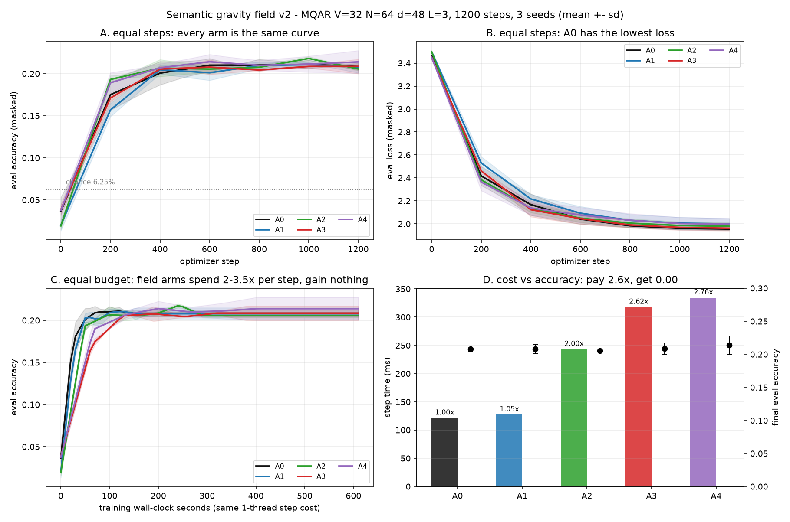
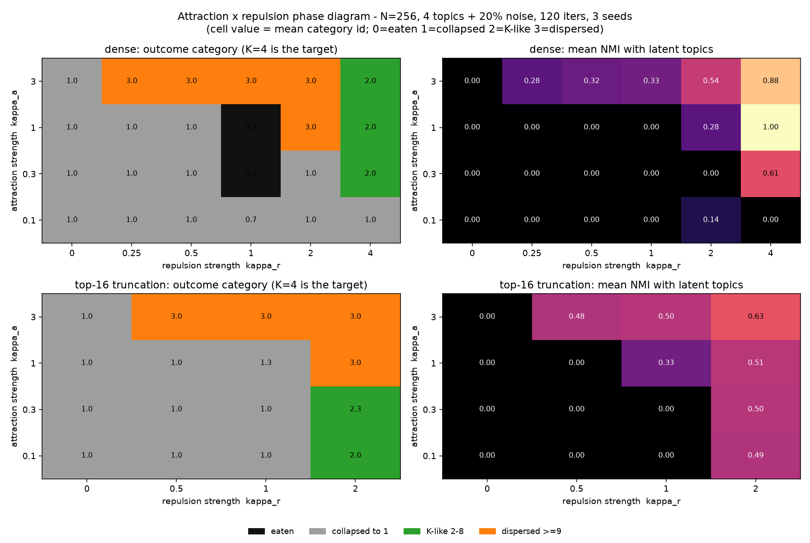

# The Semantic Gravity Field Is a Token Prior and a Cosine
### Six falsification tests for field-inspired attention

**Author:** Zhang Junbin

**Status:** preprint draft. All numbers are from the artifact in `gravity_lab/`; every claim below is reproducible from the scripts named in §7.

---

## Abstract

Physically inspired attention variants — in which tokens carry a *mass*, a *capture radius*, and interact through a distance-decaying potential — are attractive because they promise content-adaptive sparsity that dense attention cannot offer. We implement one such proposal (a "semantic gravity field", originally specified as a global attraction potential with a three-zone collapse, a mass-conserving merge rule, and an irreversible escape zone) as a single parameterised attention layer, and subject it to six independent tests. The design is exactly a softmax attention whose logit has been replaced by a monotone warp of cosine similarity plus a per-token bias; at constant bandwidth the logit is $\alpha\cos\theta+\beta\cos^2\theta+b_j$ and the fit to this form is numerically exact ($R^2=1.000000$). Beyond this algebraic reduction, we find: (i) five architecture arms are statistically indistinguishable in accuracy (0.206–0.214, chance 0.0625) while three of them cost 2.0–2.8× per optimiser step; (ii) the learned field strength *decreases* under gradient descent from three different initialisations, i.e. the optimiser votes against the mechanism; (iii) on a GPU the cost ratio *grows* with context length (2.42× at 512 → 4.83× at 2048) while the effective number of attended keys is within 0.4% of the causal baseline, so no sparsity exists to exploit; (iv) the multi-step dynamical version of the field is bistable — all-collapse or all-isolated — with no stable multi-cluster state at any scale we could reach up to N=8192; (v) as a memory-eviction rule the field is *bit-identical* to LRFU, a cache policy from 2001; and (vi) fit to the attention logits of a real pretrained transformer, the gravity basis is indistinguishable from parameter-matched control bases (ΔR² ≤ 0.003) while the full field parameterisation fits *worse*. We report these results with an explicit boundary: all tests are at small scale and with dense eagers kernels, so we falsify *deployment paths*, not the underlying metaphor. The transferable contribution is a diagnostic protocol — parameter-matched control bases, gradient-sign voting under multiple initialisations, effective-participation accounting, and cost-ratio scaling — together with six implementation traps that silently invalidate otherwise correct experiments.

---

## 1. Introduction

Attention is a kernel smoother over a learned similarity [Tsai et al. 2019]. That framing invites a natural question: should the kernel be *content-only*, or should it also decay with some notion of semantic distance? A family of proposals answers the second way. The most developed version we are aware of is the *semantic gravity field*: each token becomes a celestial body with a semantic coordinate, a positive scalar *mass* (its information density), and a *capture radius* proportional to that mass; the attention weight between two tokens is a gravitational potential, $\propto m_im_j$ divided by a power of the distance, and tokens outside every radius escape the computation entirely.

The proposal is attractive for three reasons. It promises content-adaptive sparsity, where related content interacts regardless of distance and unrelated content is dropped. It offers a physical narrative that unifies attention, forgetting, and convergence. And its "soft boundary" avoids the training instability of hard top-$k$.

The framing is not ours alone. A published formulation casts attention as spacetime curvature, with token importance as gravitational mass and the attention score as a gravitational pull, and attributes to it the ability to explain contextual meaning and disambiguation [Sharma 2025]. We therefore treat the gravity field as one specimen of a class — multiplicative attraction followed by row normalisation — rather than as a private hypothesis. That is what makes a negative result useful to anyone besides its author.

Related ideas are well established in adjacent literatures — distance-kernel attention [Peng et al. 2021], content-based sparse routing [Roy et al. 2021], radius-neighbourhood attention on point clouds [Zhao et al. 2021], radial basis embeddings on molecules [Klicpera et al. 2020] — which is itself a signal worth taking seriously.

This paper reports what happened when we built it and tried to make it work. We are explicit about the epistemic status of the result: **we did not falsify the metaphor; we falsified six specific deployments of it**, each with a different failure mode, and the failures are informative because they are the *same* failure wearing different clothes. Every place we put the field — inside the attention logit, at long context, in iterative dynamics, in memory eviction, and finally as an explanatory model of a real pretrained transformer — it collapsed into something simpler that already exists, while costing more.

The paper's contributions are:

1. **An exact reduction** (§3.1). A broad class of field attention designs is a softmax attention with a modified logit: a rank-one per-key bias plus a monotone function of cosine similarity. At constant bandwidth this is $b_j+\alpha\cos\theta+\beta\cos^2\theta$; we verify the identity to machine precision and show the query-side "mass" is provably inert.
2. **Six falsification tests** (§3.2–§3.7), each with a pre-registered decision rule, run on a single implementation whose baseline is verified bit-identical to native attention.
3. **A diagnostic protocol** (§4) that generalises beyond this design: parameter-matched control bases (a high $R^2$ is not evidence unless the basis is privileged), gradient-sign voting under multiple initialisations (does training want the term?), effective-participation accounting (does claimed sparsity exist?), and cost-ratio scaling (does the overhead shrink with size?).
4. **Six implementation traps** (Appendix A) that each produced convincing but false results in our own experiments, including a dead-gradient reparameterisation, a zero-initialisation that makes an entire anisotropic term unlearnable, and an eviction threshold that cascades to self-destruction at scale.

We also state plainly what we did *not* test: training at LLM scale, a fused block-sparse kernel that physically skips tiles, and learned dynamics inside an inference loop. §6 marks these boundaries.

---

## 2. The design under test

Let $x\in\mathbb R^{B\times N\times D}$ be a layer's input, $d_h=D/H$, and $q=xW_q,\;k=xW_k,\;v=xW_v$. The field layer computes a single logit expression whose terms are enabled by configuration flags, so that every arm in the study differs only in *which terms exist*, never in how they are computed:

$$
\ell_{ij}=\alpha_h\frac{q_i\cdot k_j}{\sqrt{d_h}}
+\mathbb 1_{\text{mass}}\log m_j
-\mathbb 1_{\text{rad}}\,\kappa_h\left(\frac{D_{ij}^2+\epsilon}{2\sigma_{ij}^2+\epsilon}\right)^{p_h/2}
+\mathbb 1_{\text{sink}}\,b_h^{\text{sink}},
\qquad w_{ij}=\mathrm{softmax}_j(\ell_{ij})
$$

with the field components

| Component | Definition | Parameters |
|---|---|---|
| Semantic mass | $\log m_j=\log\mathrm{softplus}(x_jw_m^{(h)})+b_h^{\rm mass}$ | $w_m^{(h)}\in\mathbb R^{D}$, $b^{\rm mass}$ |
| Capture radius | $r_i=\mathrm{softplus}(x_iw_r^{(h)}+c)$, $\sigma_{ij}=\tfrac{s_h}{2}(r_i+r_j)$ | $w_r^{(h)}$, $s_h>0$ |
| Anisotropic metric | $D_{ij}^2=\lVert(I+U_hU_h^\top)(\hat q_i-\hat k_j)\rVert^2$ | $U_h\in\mathbb R^{d_h\times r}$ |
| Shape exponent | $p_h=1+\mathrm{softplus}(\text{raw}_h)$ | monotone, $p\to\infty$ approximates hard truncation |
| Vacuum body | one extra key with logit $b_h^{\text{sink}}$ and value $v_h^{\text{sink}}$ | absorbs "nothing is relevant" mass |

The six arms are: **A0** native softmax attention; **A1** + key-side mass bias; **A2** + per-token bandwidth (cosine attention with learned $\sigma$); **A3** + anisotropic metric, learnable shape, and vacuum body; **A4** = A3 + irreversible escape (keys whose exponential-moving-average received mass falls below $\tau$ times the mean are permanently masked, with a straight-through gate); **A5** = A3 + mass-conserving merge of far blocks with a raw local window.

The base model is a pre-LN decoder-only transformer (width 48, 3 layers, 4 heads, learned absolute positions, tied embeddings, ~90k parameters). Training is AdamW (lr $3\times10^{-3}$, cosine, 1200 steps, batch 32); the task is multi-query associative recall (MQAR, a standard probe of in-context recall [Arora et al. 2023]) over a vocabulary of 32 with 16 key–value pairs, chance accuracy 6.25%. Every arm is run with three seeds in separate single-threaded processes. Decision rules were written down before any training run and are reproduced in Appendix B.

---

## 3. Results

### 3.1 The field is a reparameterisation, not a mechanism

Write the field weight without softmax, as the proposal originally specified:

$$
w_{ij}=\frac{m_im_j\,e^{-d_{ij}^2/2\sigma_{ij}^2}}{\sum_{j'}m_im_{j'}e^{-d_{ij'}^2/2\sigma_{ij'}^2}} .
$$

The factor $m_i$ cancels between numerator and denominator, so

$$
w_{ij}=\mathrm{softmax}_j\!\left(\log m_j-\frac{d_{ij}^2}{2\sigma_{ij}^2}\right).
$$

We verify this numerically: the maximum absolute difference between the two forms is $2.1\times10^{-17}$, i.e. exact in float32. Two consequences follow immediately.

*The query-side mass is inert.* Scaling $m_i$ by 100 while holding the bandwidth fixed changes the attention matrix by $2.4\times10^{-8}$ — numerical zero. The "mass of the query body widens its gaze" narrative is false in this parameterisation; only the *key*-side mass does anything, and it does so as a rank-one logit bias, which is exactly the kind of term softmax attention can already represent.

*Three coaxial Gaussian fields are one field.* If the three constraint fields (topic attraction, logical repulsion, contextual coupling) share a coordinate system, their product is $\exp(-d^2\sum_k 1/2\sigma_k^2)$, a single Gaussian with $\sigma_{\rm eff}$, verified bit-identical. To be three distinct mechanisms they require three distinct metrics; to be one field they need one anisotropic metric. The design we implemented takes the second route.

*At constant bandwidth the logit is a quadratic in cosine.* Since $d_{ij}^2=2-2\cos\theta_{ij}$,

$$
\ell_{ij}=b_j+\alpha\cos\theta_{ij}+\beta\cos^2\theta_{ij}+c ,
$$

and a least-squares fit of this basis to the field's own log-weights retrieves $R^2=1.000000$; removing the $\cos^2$ term leaves $R^2=0.998666$. The entire "physics" therefore occupies three real degrees of freedom per head: a key bias, a cosine slope, and a curvature. Whether that curvature earns its keep is an empirical question — and §3.2 and §3.7 answer it twice, negatively.

### 3.2 Capability at fixed budget: six arms, one curve

**Figure 1.** Six-arm ablation, MQAR (V=32, N=64, 16 key–value pairs), 1200 steps, 3 seeds, mean ± s.d. (a) accuracy against optimiser step; (b) loss; (c) accuracy against wall-clock seconds on the same one-thread step cost; (d) step cost against final accuracy.

| arm | mechanism | accuracy | loss | step (ms) | relative |
|---|---|---|---|---|---|
| **A0** | native softmax | 0.208 ± 0.005 | **1.955 ± 0.013** | 121 | 1.00× |
| A1 | + key-side mass prior | 0.208 ± 0.009 | 2.000 ± 0.058 | 127 | 1.05× |
| A2 | + learned bandwidth | 0.206 ± 0.003 | 1.979 ± 0.040 | 243 | **2.00×** |
| A3 | + anisotropy + shape + vacuum | 0.208 ± 0.011 | 1.962 ± 0.027 | 318 | **2.62×** |
| A4 | A3 + irreversible escape | 0.214 ± 0.017 | 1.997 ± 0.062 | 334 | **2.76×** |

All arms plateau at the same accuracy after 400–600 steps and then do not move for another 600. Inter-arm differences are at or below one standard deviation; on loss, the native baseline is the best of the five, and the two cheapest additions (A1, A4) are worse by more than one s.d. Whatever the field is doing, it is not adding capability at this operating point.

We note the honest caveat: no arm solves MQAR (chance 6.25%, ceiling 100%). The arms land at 20%, and the fact that they land *at the same place* is more informative than a difference would have been — it indicates the bottleneck is capacity or optimiser steps, not the attention kernel. §3.4 and §3.7 provide two independent tests that do not depend on this task being solvable.

**A noise task does not rescue it.** To test the "field only helps when there is something to filter" hypothesis, we built a needle task: one target key–value pair at a random position, 62 distractor pairs that are never queried, sequence length 128. All three arms reach accuracy 1.000 (loss 0.0010); the native baseline gets there in 700 s, A2 in 2581 s and A3 in 2468 s. There is no dilution to fix: softmax already concentrates on the matching key, measured as an effective participation of ~21 keys out of 128. With the baseline saturated there is no headroom for a filter to recover, and the field's own cost is the only remaining effect.

### 3.3 Mechanism: the optimiser votes against the field

A null accuracy difference can mean "the mechanism is equivalent" or "the mechanism is broken". We separate these by looking at what gradient descent does to the field's own strength parameters, sweeping the initialisation.

We first removed a reparameterisation defect that silently froze the shape exponent $p$: with $p=1+\mathrm{softplus}(\text{raw})$ initialised at $p_0=1$, we have $\text{raw}\approx-13.8$ and $\partial p/\partial\text{raw}=\sigma(\text{raw})\approx10^{-6}$, so $p$ cannot move. Initialising at $p_0=1.2$ (slope 0.18) unfreezes it.

| $\kappa$ init | $\kappa$ after 400 steps | $p$ after 400 steps | accuracy | loss |
|---|---|---|---|---|
| 0.1 | **0.071** ↓ | **1.199** ↓ | 0.209 | 2.199 |
| 1.0 | **0.931** ↓ | **1.192** ↓ | 0.207 | 2.103 |
| 3.0 | **2.977** ↓ | **1.199** ↓ | 0.159 | 2.520 |

From every initialisation the field strength shrinks, and the shape exponent drifts *softer*, i.e. toward less truncation — the opposite of the design intent, which is that training sharpens the kernel toward a hard boundary. A large enough field is actively harmful: at $\kappa_0=3$ accuracy falls to 0.159 and loss degrades by 0.4. On the needle task the sign flips (A3: $0.10\to0.172$, A2: $1.00\to1.055$), which supports the view that the field is responding to task structure rather than being broken outright — but since accuracy is saturated at 1.000 there, the flip buys exactly nothing.

### 3.4 Scale: the cost ratio grows, and there is no sparsity to sell

The natural objection to §3.2 is that a short-sequence, low-noise task is the wrong arena. We therefore measured the arms on a compute node (AMD DCU, ROCm 6.3, torch 2.9.0, 68.7 GB), batch 4, fp32, width 64, 4 layers, at sequence lengths 512/1024/2048.

| seq | A0 (ms) | A2 | A3 | A4 | A0 peak mem | A3 peak mem |
|---|---|---|---|---|---|---|
| 512 | 11.9 | 1.77× | **2.42×** | 2.58× | 0.21 GB | 0.80 GB |
| 1024 | 13.4 | 3.41× | **3.98×** | 4.28× | 0.78 GB | 3.11 GB |
| 2048 | 37.3 | 4.16× | **4.83×** | 5.24× | 3.01 GB | 12.26 GB |

The ratio rises monotonically and does not turn over. The reason is structural rather than accidental: the field's additional work is itself $O(N^2)$ — it materialises roughly five extra $N\times N$ tensors (distance, bandwidth sum, power, exponential, mass product) on the same grid as the attention scores. As attention becomes the dominant cost, the field's relative overhead converges to the ratio of per-pair work, about 5×; it never converges to 1. An earlier version of this analysis predicted a crossover near $N\approx1900$ based on attention's share of FLOPs; that prediction is wrong for exactly this reason and we record the correction.

Memory is the harder wall. Peak allocation for A0 follows the expected $O(N^2)$ (0.21 → 0.78 → 3.01 GB) and A3 tracks it at 3.84–4.07×. Extrapolating from the measured points, A3 at $N=8192$ needs about 200 GB and A0 about 49 GB, so neither can be run on a single 68.7 GB device at batch 4 in a dense implementation.

Crucially, **the sparsity that would justify all of this does not exist.** The effective number of attended keys, $1/\sum_j w_{ij}^2$ averaged over queries, is 256.4 / 512.3 / 1024.2 for A0 and 255.8 / 510.7 / 1019.6 for A3 at the three lengths — a difference of 0.2–0.4%, and in all cases equal to the causal expectation $(N+1)/2$. The field redistributes weight slightly; it does not remove any key. A4's irreversible escape does reduce the effective KV set, to 70.4% of dense, at 5.24× the cost of A0.

### 3.5 Dynamics: self-organisation is bistable, not hierarchical

The strongest claim in the original proposal is not about a single forward pass but about a multi-step process: units of similar meaning attract and merge into heavier bodies, irrelevant bodies are flung out of the field, and a "core star / planet / moon" hierarchy emerges spontaneously. This is testable without training, as an iterated map on a cloud of vectors, and it is the one place where the earlier cost objection cannot apply because there is no $N^2$ attention term.

We iterate on the unit sphere: at each step $x\leftarrow\mathrm{normalize}(x+\lambda(Wx-x))$, where $W$ is a softmax of the field logits; mass comes from an unsupervised density statistic (mean cosine to all other units), so the labels are never used. The initial cloud is 4 latent topics of 64 units each plus 20% uniform noise (N=256, 120 iterations).

| arm | clusters at $t=0\to120$ | live units | hierarchy probe |
|---|---|---|---|
| native softmax | 256 → **1** | 256 → 256 | 1.0 |
| field, global | 256 → **1** | 256 → 256 | 1.0 |
| field + merge + escape | 256 → **1** | 256 → 220 | 1.0 |

All three collapse to a single consensus. A control arm is essential here: iterated softmax self-attention is already known to produce clustering [Geshkovski et al. 2025], so "clusters appeared" is not evidence of anything. What would be evidence is a *stable multi-cluster* state that the control cannot reach.

Sweeping the capture radius $\sigma$ does not produce one. The system is bistable: for small $\sigma$ every unit is isolated (256 clusters, maximal NMI trivially 0.50 for singletons); for any $\sigma\gtrsim0.15$ the whole cloud collapses to one cluster (NMI 0). There is no intermediate regime at the ground-truth $K=4$.

Because the collapse is caused by attractors swallowing everything, we added the missing ingredient the original design never specified — a competitive (lateral-inhibition) repulsion term, $\ell_{ij}\leftarrow\ell_{ij}-\kappa_r\,\mathrm{zscore}(\sum_i w_{ij})$ — and mapped the $(\kappa_a,\kappa_r)$ plane over 60 configurations with three seeds each.

**Figure 2.** Attraction × repulsion phase diagram. $\kappa_r=0$: 12/12 configurations collapse to a single cluster. $\kappa_r>0$: a K-like state (2–8 clusters, NMI ≥ 0.5) appears in 8/60 dense configurations and 3/36 top-16 configurations — but in 0/40 of those that retain at least 32 units. Cells where NMI reaches 1.00 are configurations that ate 87% of the units; the "perfect" clustering of three survivors is a selection effect.

Repulsion does move the system out of the single-attractor basin, which substantiates the diagnosis that the rule set lacked competition. It does not create a stable hierarchical attractor: the best-looking configuration gives 3 clusters in one seed and 1 cluster in the other two. Scaling up makes it worse — with the escape cascade repaired (see Appendix A.5), at $\kappa_a=1.0$ and $N=1024/4096/8192$ all nine configurations collapse to one cluster with NMI 0. Collapse is not a small-$N$ artefact; it strengthens with $N$, because every row of a global softmax drifts toward the global mean.

### 3.6 Substrate: as a memory rule, the field is LRFU

A memory store has no $N^2$ pairwise term — scoring is $O(N)$ per query — so the cost argument of §3.4 does not apply. This is the most favourable substrate the idea could have, and it is the one the proposal's own narrative ("mass decays, cores aggregate, irrelevant memories escape") points at.

We simulate a Zipf$(s=1)$ access stream over $V=4096$ items with store capacity $C=512$ and compare replacement policies by hit rate over 200k accesses.

| policy | hit rate |
|---|---|
| FIFO | 0.6296 |
| LRU | 0.6766 |
| LFU | 0.7319 |
| mass-decay, $d=0.9$ / $0.99$ | 0.6560 |
| mass-decay, $d=0.999$ | 0.7034 |
| mass-decay, $d=0.9999$ | **0.7462** |
| **gravity (mass × capture radius)** | **identical to mass-decay, $|\Delta|=0.000\mathrm{e}{+}00$** |

"Accumulate mass on access, decay it, evict the lightest" is LRFU [Lee et al. 2001], the classic policy family that interpolates between LRU and LFU; the hit-rate sequence 0.656 → 0.703 → 0.746 is exactly an LRFU curve. The mechanism is genuinely useful — 10.3% relative over LRU — and genuinely 25 years old. The capture-radius term contributes *exactly zero*, because without a metric on the store, distance is a constant and the ranking induced by $\log m_j-\kappa(d^2/2\sigma_j^2)^{p/2}$ is the ranking induced by $\log m_j$. To make the radius act, one must introduce content distance, at which point the rule becomes recency + relevance + importance, i.e. the additive form again.

### 3.7 Explanation: the gravity basis has no privilege

If the design is a reparameterisation, a natural last hope is that it is a *useful* one — that real trained attention already implements something gravity-like, making the metaphor an interpretive lens. We test this directly.

We take distilgpt2 (6 layers × 12 heads, 82M parameters) over 122 real tokens, extract $q$ and $k$ from the model's fused `c_attn` projection, and verify that our reconstruction reproduces the model's own attention to $2.4\times10^{-7}$. The target is the row-centred attention logit; we fit candidate bases with 5-fold cross-validation over query rows and report held-out $R^2$.

The design point that matters: a high $R^2$ is not evidence. A free per-key constant $b_j$ alone already explains 0.59. What we ask is the *increment* over that bias, and whether the gravity basis beats bases with the same number of free parameters.

| basis | held-out $R^2$ | increment over $b_j$ |
|---|---|---|
| $b_j$ only | 0.5917 | — |
| $\alpha\cos\theta$ | 0.8216 | +0.2298 |
| $\alpha\cos\theta+\beta\cos^2\theta$ (**gravity identity**) | 0.8252 | +0.2335 |
| $\alpha\cos\theta+\beta\cos^3\theta$ (control) | 0.8251 | +0.2333 |
| $\alpha\cos\theta+\beta\cos^5\theta$ (control) | 0.8243 | +0.2326 |
| $\alpha\cos\theta+\beta\,\mathbb 1[\cos\theta>\tau]$ (control) | 0.8226 | +0.2309 |
| full field: per-token mass + per-pair radius + $\kappa,p$ | 0.7258 | +0.1340 |

Three findings. First, 99.6% of the achievable $R^2$ comes from a single cosine term; gravity's characteristic curvature adds 0.0036. Second, the gravity basis is statistically indistinguishable from arbitrary parameter-matched bases on the cosine spectrum (Δ$R^2$ = 0.0002 / 0.0009 / 0.0026). Third, the *full* field parameterisation — the one with the three "interpretable" parameters — fits **worse** out of sample (0.7258), by 0.0994, because the per-token radii overfit the bandwidth.

Real attention logits, in this model, decompose into a per-token prior (59%) plus a cosine coefficient (23%), with four tenths of a percent left over. Naming that residue "gravity" adds no explanatory power, because every monotone function of cosine fits it equally well.

---

## 4. A diagnostic protocol for field-inspired designs

The results above are about one design, but the tests are not. We recommend the following four checks, each of which caught us making a mistake.

**4.1 Reduce before implementing.** Write the proposed weight without normalisation and normalise symbolically. Any design of the form $\sum_j f_i g_j h(d_{ij})/\sum_j(\cdot)$ loses its query-side factor $f_i$ immediately. Then expand the distance around the similarity and ask what function space the logit actually spans. If it spans $b_j$ plus a monotone function of the baseline similarity, the proposal is a reparameterisation, and the burden of proof shifts to showing that the *particular* monotone function matters.

**4.2 Use parameter-matched control bases.** A high $R^2$ means nothing on its own. Fit the proposal's basis against equally-sized alternatives on the same target and report the difference. In our case the proposal loses to a step function by 0.0026, i.e. it is not privileged.

**4.3 Use gradient-sign voting, not accuracy.** If a term is redundant, gradient descent will shrink its coefficient; sweeping the *initial* coefficient and reporting the direction of change is a far more sensitive test than accuracy, which is dominated by variance. Our design shrank the field from 0.1, 1.0 and 3.0 simultaneously — evidence of redundancy, not of a small effect. Conversely, on the noise task the coefficient grew: the same diagnostic detected a real (if useless) task dependence.

**4.4 Account for sparsity before claiming it.** "Content-adaptive sparsity" is a claim about the effective number of attended keys. Report $1/\overline{\sum_j w_{ij}^2}$ against the causal baseline. A soft decay does not produce sparsity: ours differed from the baseline by 0.4% at every length, and 0.2% at N=512, where the claim was made loudest.

**4.5 Fit the cost ratio, not the cost.** Measure the ratio at several lengths. A dense $O(N^2)$ mechanism whose claimed benefit is asymptotic must show a *decreasing* ratio; ours increased 2.42× → 4.83×, which is the signature of a dense reparameterisation rather than a sparse mechanism.

---

## 5. Discussion

The pattern across the six tests is uniform, and we think it is the paper's real content: **the field is a low-dimensional function of similarity wearing a physical costume, and every substrate we placed it in had already solved that function more cheaply.** In the attention logit it is a softplus temperature and a token bias. At long context it is a dense reparameterisation with five extra $N^2$ tensors. In iterative dynamics it lacks the repulsion that would be needed to prevent consensus collapse — and when we supplied a generic form of repulsion it produced instability, not structure. In a memory store it is LRFU exactly, to the bit. As an explanation it is one of many equally good monotone warps of cosine.

Two things survive, and they are not nothing.

The **per-token prior** is real and large: 59% of the log-attention structure in a trained model is a per-key constant, consistent with the attention-sink literature [Xiao et al. 2023] and with heavy-hitter eviction [Zhang et al. 2023]. If one wants a physical story, "some tokens are heavy and attract attention regardless of content" is supported; "attention decays with semantic distance" is not, and is in fact contradicted by the cosine term explaining four times more variance than any curvature could add.

The **memory result** is a genuine positive: decayed-mass eviction beats LRU by 10.3% relative on a Zipf stream. It is worth deploying. It is also 25 years old, and citing it as such is more useful to a reader than repackaging it.

### What we are not claiming

We falsified deployments, not the metaphor, and the boundary matters.

*Scale.* Our trained model has 90k parameters and never solves its task; the GPU measurements use an eager dense implementation. A fused kernel that physically skips tiles would change §3.4's cost conclusion, though not §3.4's sparsity finding — there is no sparsity to skip.

*Learning the dynamics.* Our dynamics (§3.5) are hand-specified, not learned end-to-end inside a model's inference loop. A trainable iterative memory, where the merge and escape rules are optimised for a downstream objective, is a different object and remains untested.

*A different monotone function might earn its keep.* Our result is that the gravity basis is not privileged among monotone warps of cosine **on this task and this model**. A task whose optimal logit is genuinely non-monotone in similarity could prefer one warp over another; we did not find or construct one.

### What would change our mind

A single experiment would overturn §3.4: a block-sparse implementation of the same field that realises a measured effective-participation reduction of 2× or more, at accuracy parity, with a cost ratio below 1. We looked for that sparsity for three sequence lengths on two platforms and did not find it in the dense formulation; producing it would require the mechanism to *create* sparsity, which is precisely what it failed to do.

---

## 6. Relation to prior work

The genre this paper belongs to has been argued for explicitly. [Karl et al. 2024] call for publishing results whose value is not captured by predictive performance, noting that a performance-only criterion distorts community incentives. Our contribution should be read in that frame: the deliverable is a reduction and a diagnostic protocol, not a better model.

Physics-inspired attention also has a success case that clarifies what success looks like. Modern Hopfield networks are an energy-based analogy that *did* yield a theorem — attention is their energy minimisation, with provable capacity [Ramsauer et al. 2021]. The difference between that and the gravity analogy is precisely whether an exact correspondence can be written down; §3.1 answers that question for the multiplicative-attraction family, and the answer is that the correspondence exists but is degenerate: it lands on softmax with a token bias.

Distance-decaying attention is not new, and most of the value in this design is already available in cheaper forms: RBF-kernel attention and its random-feature linearisation [Peng et al. 2021; Choromanski et al. 2021], linear attention [Katharopoulos et al. 2020], content-based sparse routing [Roy et al. 2021; Kitaev et al. 2020], fixed sparse patterns with global tokens [Beltagy et al. 2020; Zaheer et al. 2020], and radius-neighbourhood attention in geometric deep learning [Zhao et al. 2021; Klicpera et al. 2020]. The kernel view of attention [Tsai et al. 2019] is the right frame for reading our negative result: the proposal is a kernel choice, and kernel choices that are monotone warps of the same similarity are not distinguished by softmax.

The dynamical claim intersects a known theoretical result: iterated self-attention on the sphere clusters [Geshkovski et al. 2025], so clustering cannot be used as evidence for a new mechanism without a control. Long-context efficiency is measured against fused attention [Dao et al. 2022] in production settings, which makes eager dense comparisons optimistic for the field, not pessimistic. Associative recall as a probe follows [Arora et al. 2023]. Memory eviction policies with decayed frequency are classical [Lee et al. 2001] and modern LLM analogues exist [Zhang et al. 2023; Xiao et al. 2023], which is why §3.6's conclusion — that the field memory *is* LRFU — is a deflation rather than a discovery.

---

## 7. Reproducibility

All results come from one artifact with a frozen interface and twelve contract tests, including bit-exact equivalence of the baseline arm to native attention (`maxerr = 0.00e+00`), invariance of the mass bias to constant shifts, and mass conservation of the merge rule to $9.8\times10^{-8}$. CPU experiments run on 4 cores; GPU experiments on an AMD DCU (ROCm 6.3, torch 2.9.0). Every decision rule in §3 was written before the corresponding run (Appendix B). Raw per-run JSON, the phase-diagram sweeps, the memory traces and the attention fits are included; a single command reproduces each table. Code and raw results: https://github.com/PD-Dount/semantic-gravity-field

---

## Appendix A. Six implementation traps

Each of these produced a confident but wrong conclusion during the study. They are listed because they are cheap to fall into and expensive to notice.

**A.1 No positional encoding makes an associative-recall task unlearnable.** Our first implementation had token embeddings only, and attention's logit is purely content-based. On MQAR every arm sat at chance (accuracy 0.048 vs chance 0.031 after 600 steps), which reads as "the mechanism does not help". It was not; the model could not represent "the token *after* the matching key". Adding a learned absolute position fixed it. Worse, a single fixed batch reaches accuracy 1.000 within 100 steps by memorisation, so a fixed-batch evaluation produces a false positive. Always evaluate on held-out batches.

**A.2 Zero initialisation can freeze an entire term.** The anisotropic metric uses $D^2=\lVert(I+UU^\top)z\rVert^2$, which is *even* in $U$. At $U=0$ the gradient is exactly zero (we measured `U.grad.max() == 0.0`), so the anisotropy never leaves the identity metric. Small random initialisation (std 0.01) fixes it.

**A.3 A mass-conservation rule that cannot hold.** Specifying $M_m=\sum_j\pi_{jm}m_j$ with per-block normalised $\pi$ ($\sum_j\pi_{jm}=1$) contradicts $\sum_m M_m=\sum_j m_j$: it holds only when $\pi\equiv1$. Implemented literally, conservation is off by the block size (measured 9.0e-01 relative error at $g=8$). The consistent choice is $M_m=\sum_j m_j$ with $\pi$ weighting only the merged key and value.

**A.4 A denominator that silently scales a radius.** The merged block radius must be averaged with the same weights as the merged key, i.e. divided by $\sum_j\pi_{jm}m_j$. Dividing by the block total mass instead makes the radius smaller by roughly the block size, which changes every downstream bandwidth.

**A.5 An eviction threshold that cascades to self-destruction.** "Remove keys whose received mass is below $\epsilon$ times the mean" uses a threshold that *rises* as keys are removed: removal concentrates softmax mass on survivors, raising the mean, which removes more. At $N=256$ this fires on 0–2% of keys and looks harmless; at $N=1024$ and above it removes **everything** (measured: 1024/1024 units). The fix is to threshold against the initial mass scale and cap removals per step. Irreversible removal at scale is only safe with an absolute reference.

**A.6 A reparameterisation with a dead gradient.** $p=1+\mathrm{softplus}(\text{raw})$ initialised at $p_0=1$ has $\text{raw}\approx-13.8$ and slope $10^{-6}$, so the parameter is frozen: we measured $p_{\rm mean}=1.0000$ after 1200 steps under three different field strengths, which we initially read as "the mechanism is inert" rather than "the parameterisation is". Initialising at $p_0=1.2$ changed the conclusion (§3.3).

---

## Appendix B. Pre-registered decision rules

Written before the corresponding runs, reproduced verbatim in translation.

| id | hypothesis | criterion |
|---|---|---|
| H1 | A3 beats A0 at matched parameters | Δaccuracy ≥ +0.03 with all three seeds agreeing in sign, or ≥25% fewer steps to a fixed accuracy |
| H2 | the gain comes from the field, not the token prior | Δ(A3−A0) exceeds half the sum of Δ(A1−A0) and Δ(A2−A0) |
| H3 | irreversible escape compresses KV without loss | Δaccuracy(A4−A3) ≥ −0.01 and KV length down ≥30% |
| H4 | sparsity converts into compute | effective participation down ≥2× at equal accuracy, modelled FLOPs down ≥30% |

Outcomes: H1 not supported (Δ = +0.000); H2 not supported (A1 alone already matches A0); H3 half-supported (KV 70.4%, accuracy +0.006, but 5.24× cost); H4 not supported (effective participation 22.8 → 17.3, cost 2.6× higher).

---

## References

1. Vaswani, A. et al. Attention is all you need. *NeurIPS* (2017).
2. Tsai, Y.-H. H. et al. Transformer dissection: a unified understanding of transformer's attention via the lens of kernel. *EMNLP* (2019). arXiv:1908.11775.
3. Katharopoulos, A., Vyas, A., Pappas, N., Fleuret, F. Transformers are RNNs: fast autoregressive transformers with linear attention. *ICML* (2020). arXiv:2006.16236.
4. Choromanski, K. et al. Rethinking attention with Performers. *ICLR* (2021). arXiv:2009.14794.
5. Peng, H., Pappas, N., Yogatama, D., Schwartz, R., Smith, N. A., Kong, L. Random feature attention. *ICLR* (2021). arXiv:2103.02143.
6. Roy, A., Saffar, M., Vaswani, A., Grangier, D. Efficient content-based sparse attention with routing transformers. *TACL* (2021). arXiv:2003.05997.
7. Kitaev, N., Kaiser, Ł., Levskaya, A. Reformer: the efficient transformer. *ICLR* (2020). arXiv:2001.04451.
8. Beltagy, I., Peters, M. E., Cohan, A. Longformer: the long-document transformer. arXiv:2004.05150 (2020).
9. Zaheer, M. et al. Big Bird: transformers for longer sequences. *NeurIPS* (2020). arXiv:2007.14062.
10. Dao, T., Fu, D. Y., Ermon, S., Rudra, A., Ré, C. FlashAttention: fast and memory-efficient exact attention with IO-awareness. *NeurIPS* (2022). arXiv:2205.14135.
11. Zhao, H., Jiang, L., Jia, J., Torr, P., Koltun, V. Point Transformer. *ICCV* (2021). arXiv:2011.00952.
12. Klicpera, J., Groß, J., Günnemann, S. Directional message passing for molecular graphs. *ICLR* (2020). arXiv:2003.03123.
13. Arora, S. et al. Zoology: measuring and improving recall in efficient language models. arXiv:2312.04927 (2023).
14. Geshkovski, B., Letrouit, C., Polyanskiy, Y., Rigollet, P. A mathematical perspective on Transformers. *Bull. Amer. Math. Soc.* 62, 427–479 (2025). arXiv:2312.10794.
15. Xiao, G., Tian, Y., Chen, B., Han, S., Lewis, M. Efficient streaming language models with attention sinks. *ICLR* (2024). arXiv:2309.17453.
16. Zhang, Z. et al. H₂O: heavy-hitter oracle for efficient generative inference of large language models. *NeurIPS* (2023). arXiv:2306.14048.
17. Lee, D., Choi, J., Kim, J.-H., Noh, S. H., Min, S. L., Cho, Y., Kim, C.-S. LRFU: a spectrum of policies that subsumes the least recently used and least frequently used policies. *IEEE Trans. Computers* 50(12), 1352–1361 (2001).
18. Radford, A. et al. Language models are unsupervised multitask learners. OpenAI technical report (2019).
19. Sanh, V., Debut, L., Chaumond, J., Wolf, T. DistilBERT, a distilled version of BERT. arXiv:1910.01108 (2019).
20. Sharma, R. Attention as spacetime curvature: a general relativistic analogy for language models. Zenodo, DOI 10.5281/zenodo.15718512 (2025).
21. Karl, F., Kemeter, L. M., Dax, G., Sierak, P. Position: embracing negative results in machine learning. arXiv:2406.03980 (2024).
22. Ramsauer, H. et al. Hopfield networks is all you need. *ICLR* (2021). arXiv:2008.02217.
