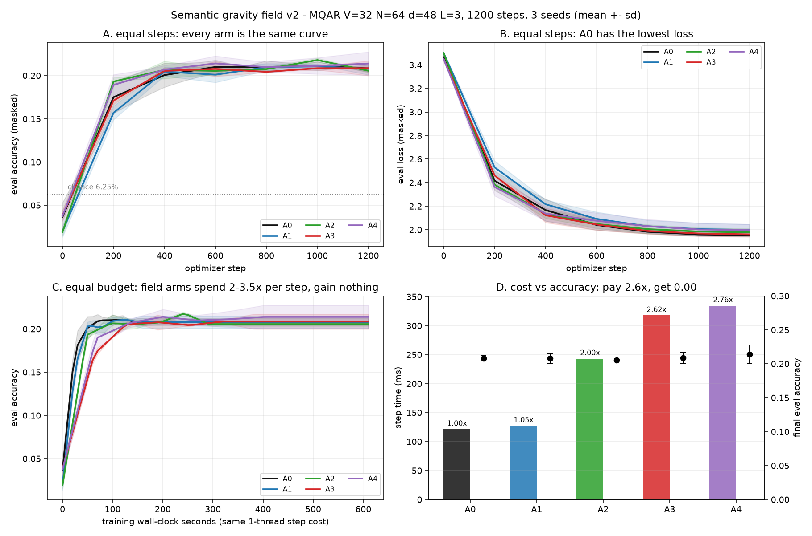
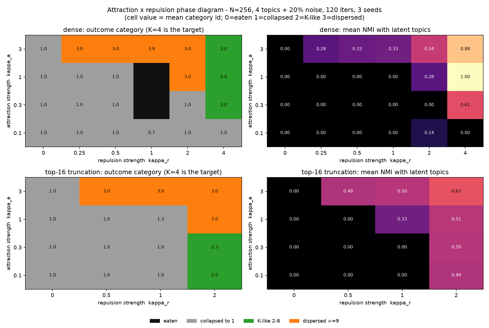

# 语义引力场就是一个 token 先验加一条余弦
### 面向"场式注意力"的六项证伪实验与技术报告

**作者：** 张俊滨

**状态：** 预印本草稿。全部数字来自 `gravity_lab/` 制品，§7 给出复现路径。

---

## 摘要

物理启发的注意力变体——给 token 赋予**质量**与**捕获半径**、用距离衰减势决定交互强度——很有吸引力，因为它承诺稠密注意力给不了的内容自适应稀疏。我们把一份完整的"语义引力场"提案（全局吸引势 + 三区坍缩 + 质量守恒合并 + 不可逆逃逸）实现为单一参数化注意力层，并对它做六项独立检验。

结论先行：该设计在代数上**恰好等于**一个 logit 被改写的 softmax 注意力——logit 是余弦相似度的单调变换加一个逐 token 偏置；带宽恒定时精确为 $\alpha\cos\theta+\beta\cos^2\theta+b_j$，拟合 $R^2=1.000000$。在此基础上：(i) 五个臂在等参数量、等步数下精度统计打平（0.206–0.214，随机基线 0.0625），其中三个臂每步贵 2.0–2.8 倍；(ii) 从三个不同初值出发，梯度下降**一律把场强度调小**；(iii) 在 GPU 上成本比随序列变长**单调上升**（512 时 2.42× → 2048 时 4.83×），而有效参与 key 数与因果基线只差 0.4%——没有稀疏可以兑现；(iv) 多步动力学版本呈双稳态（全坍缩或全隔离），到 N=8192 都没有稳定的多簇解；(v) 作为记忆淘汰规则，它与 2001 年的 LRFU **逐位相同**；(vi) 用引力基拟合真实预训练模型的注意力 logit，与同参数量的控制基**无差别**（ΔR² ≤ 0.003），而完整场参数化拟合**更差**。

以上全部限定在小尺度、稠密实现内。我们证伪的是**落地路径**，不是隐喻本身。可迁移的产出是一套诊断协议（参数匹配控制基、多初值梯度投票、有效参与数记账、成本比标定），以及六个会静默毁掉实验的实现陷阱。

---

## 1. 引言

注意力本质上是一个关于学习到的相似度的核平滑器。既然如此，一个自然的问题是：核应该**只看内容**，还是也应该随某种"语义距离"衰减？"语义引力场"给出了后一种答案：每个 token 是一个带质量与半径的天体，权重是引力势，超出所有半径的单元直接退出计算。

我们把它建出来、跑完了、然后写下发生了什么。需要说清楚的是**结论的口径**：这条"引力/场"路线并非只存在于我们这里——已有公开发表的文献把注意力解释为时空曲率、把 token 重要性类比为引力质量[Sharma 2025]，并给出了可检验的主张。我们检验的是**这一整类设计**（乘性吸引 + 行归一化）的落地方式，而不是一个私人假设。

贡献三条：

1. **一个精确归约**（§3.1）：一大类场式注意力 = softmax + 秩一 key 偏置 + 余弦的单调函数；查询侧质量可证无效。
2. **六项证伪实验**（§3.2–3.7），判据预注册，基线经逐位校验与原生注意力一致。
3. **一套诊断协议**（§4）与**六个实现陷阱**（附录 A），后者每一条都曾在我们的实验里制造过可信但错误的结果。

---

## 2. 被测设计

所有臂共用**同一个 logit 表达式**，只靠开关把项置零（禁止每臂一套 forward，否则消融测的是实现差异）：

$$
\ell_{ij}=\alpha_h\frac{q_i\cdot k_j}{\sqrt{d_h}}
+\mathbb 1_{\text{mass}}\log m_j
-\mathbb 1_{\text{rad}}\,\kappa_h\left(\frac{D_{ij}^2+\epsilon}{2\sigma_{ij}^2+\epsilon}\right)^{p_h/2}
+\mathbb 1_{\text{sink}}\,b_h^{\text{sink}},\qquad w_{ij}=\mathrm{softmax}_j(\ell_{ij})
$$

分量：质量 $\log m_j=\log\mathrm{softplus}(x_jw_m)+b$；半径 $r_i=\mathrm{softplus}(x_iw_r+c)$、$\sigma_{ij}=\frac{s_h}{2}(r_i+r_j)$；各向异性距离 $D^2=\lVert(I+UU^\top)(\hat q_i-\hat k_j)\rVert^2$；形状指数 $p=1+\mathrm{softplus}(\text{raw})$；真空天体（吸收"全都不相关"的质量）。

六个臂：**A0** 原生 softmax；**A1** + key 侧质量偏置；**A2** + 可学带宽；**A3** + 各向异性 + 可学形状 + 真空；**A4** = A3 + 不可逆逃逸；**A5** = A3 + 质量守恒远场合并。

底座：pre-LN 解码器（宽 48、3 层、4 头、可学习绝对位置、约 9 万参数）。任务：MQAR 联想召回（V=32、16 组键值，随机基线 6.25%）。AdamW、lr 3e-3、1200 步、batch 32、3 个 seed、单线程独立进程。判据在跑之前写死（附录 B）。

---

## 3. 结果

### 3.1 场是重参数化，不是机制

按原方案不计 softmax 的写法：$w_{ij}=\dfrac{m_im_j e^{-d^2/2\sigma^2}}{\sum_{j'}m_im_{j'}e^{-d^2/2\sigma^2}}$。$m_i$ 上下约掉，故

$$w_{ij}=\mathrm{softmax}_j\!\left(\log m_j-\frac{d_{ij}^2}{2\sigma_{ij}^2}\right)$$

数值验证两种写法最大差 $2.1\times10^{-17}$——在 float32 里精确相等。三个直接后果：

- **查询侧质量完全无效**：固定带宽、把 $m_i$ 放大 100 倍，注意力矩阵最大变化 $2.4\times10^{-8}$。"大质量天体视野更广"在这个参数化里不成立；只有 key 侧质量起作用，而它就是一个秩一 logit 偏置——softmax 本来就能表示。
- **三个同轴高斯场等于一个场**：$\prod_k e^{-d^2/2\sigma_k^2}=\exp(-d^2\sum_k 1/2\sigma_k^2)$，实测逐位相等。要做成三个独立机制，必须三套不同度规。
- **带宽恒定时 logit 是余弦的二次型**：$d^2=2-2\cos\theta$ 代入得 $\ell_{ij}=b_j+\alpha\cos\theta+\beta\cos^2\theta+c$，拟合 $R^2=1.000000$，去掉 $\cos^2$ 项剩 $0.998666$。整套"物理"实际只占每头三个自由度：一个 key 偏置、一个余弦斜率、一个曲率。

### 3.2 等预算下的能力：六条曲线是同一条

| 臂 | 机制 | 精度 | loss | 单步 | 相对 |
|---|---|---|---|---|---|
| **A0** | 原生 softmax | 0.208±0.005 | **1.955±0.013** | 121 ms | 1.00× |
| A1 | + key 侧质量先验 | 0.208±0.009 | 2.000±0.058 | 127 ms | 1.05× |
| A2 | + 可学带宽 | 0.206±0.003 | 1.979±0.040 | 243 ms | **2.00×** |
| A3 | + 各向异性+形状+真空 | 0.208±0.011 | 1.962±0.027 | 318 ms | **2.62×** |
| A4 | A3 + 不可逆逃逸 | 0.214±0.017 | 1.997±0.062 | 334 ms | **2.76×** |

所有臂在 400–600 步一起进平台，之后 600 步不动。臂间差 ≤ 1 个 seed 标准差；loss 上原生基线最好，两个最便宜的加法（A1、A4）反而差出一个标准差以上。

需要诚实标注：没有臂解出 MQAR（随机 6.25%，上限 100%），大家停在 20%。它们**停在同一个地方**这件事比"有差异"更有信息量——瓶颈在容量或步数，不在注意力核。§3.4 与 §3.7 两项检验不依赖这个任务可解。

**换个噪声任务救不回来。** 我们另建 needle 任务：1 个目标键值对随机位置 + 62 个永不被查询的干扰对，长度 128。三个臂都是精度 1.000（loss 0.0010）；原生基线 700 秒到，A2 2581 秒，A3 2468 秒。**不存在可修的"稀释"**：softmax 自己就把权重压到约 21 个 key 上（128 中）。基线满分，筛选机制没有可提升的空间，只剩成本。

### 3.3 机制：优化器投票反对这个场

精度打平可能是"等价"，也可能是"坏了"。用梯度对场强度参数的处置来区分。先排除一个重参数化死梯度：$p=1+\mathrm{softplus}(\text{raw})$ 取 $p_0=1$ 时 $\text{raw}\approx-13.8$、斜率 $10^{-6}$，$p$ 永远不动；改 $p_0=1.2$（斜率 0.18）才解冻。

| $\kappa$ 初值 | 400 步后 $\kappa$ | 400 步后 $p$ | 精度 | loss |
|---|---|---|---|---|
| 0.1 | **0.071** ↓ | 1.199 ↓ | 0.209 | 2.199 |
| 1.0 | **0.931** ↓ | 1.192 ↓ | 0.207 | 2.103 |
| 3.0 | **2.977** ↓ | 1.199 ↓ | 0.159 | 2.520 |

**从任何初值出发，场强度都在缩小**；形状指数一律往"更软"走——与"训练把核磨向硬边界"的设计意图相反。场给得太大直接有害：$\kappa_0=3$ 时精度掉到 0.159、loss 恶化 0.4。needle 任务上符号翻转（A3：0.10→0.172），说明场确实在响应任务结构——但那边精度已满分，翻转买不到任何东西。

### 3.4 规模：成本比随长度上升，而且没有稀疏可卖

短序列是不是错怪了它？我们在算力节点（AMD DCU，ROCm 6.3，68.7 GB）上测 batch 4、fp32、宽 64、4 层、长度 512/1024/2048：

| seq | A0 | A2 | A3 | A4 | A0 峰值 | A3 峰值 |
|---|---|---|---|---|---|---|
| 512 | 11.9 ms | 1.77× | **2.42×** | 2.58× | 0.21 GB | 0.80 GB |
| 1024 | 13.4 ms | 3.41× | **3.98×** | 4.28× | 0.78 GB | 3.11 GB |
| 2048 | 37.3 ms | 4.16× | **4.83×** | 5.24× | 3.01 GB | 12.26 GB |

比值单调上升且不回头。原因是结构性的：**场的额外开销本身是 O(N²)**——它在同一张 N×N 网格上再物化约五张张量（距离、带宽和、幂、指数、质量积）。注意力越主导，比值越收敛到"每对元素算子数之比 ≈ 5×"，而不是收敛到 1×。我们此前基于"注意力占 FLOPs 比例随 N 上升"预测 N≈1900 会出现交叉点，**该预测是错的**，特此更正。

显存更早撞墙：A0 峰值随 N²（0.21→0.78→3.01 GB），A3 是其 3.84–4.07 倍。外推 N=8192：A3 约 200 GB、A0 约 49 GB，单卡 68.7 GB 谁都跑不了。

**最关键：支撑这一切的稀疏根本不存在。** 有效参与 key 数 $1/\overline{\sum_j w_{ij}^2}$ 在三档长度上，A0 为 256.4/512.3/1024.2，A3 为 255.8/510.7/1019.6——差 0.2–0.4%，且都等于因果期望 $(N+1)/2$。场只是轻微重分布权重，没有挤掉任何 key。A4 的不可逆逃逸把 KV 压到 70.4%，代价 5.24×。

### 3.5 动力学：自组织是双稳态，不是层级

原方案最强的主张不在单步前向，而在多步演化：相近单元吸引合并成更大天体、无关天体被甩出场、自发形成"核心-行星-卫星"层级。这可以不训练直接测。

在单位球上迭代 $x\leftarrow\mathrm{normalize}(x+\lambda(Wx-x))$，$W$ 为场 logit 的 softmax，质量取无监督密度统计（不含标签）。初始 4 个潜在主题各 64 个单元 + 20% 均匀噪声（N=256，120 次迭代）。

| 臂 | 簇数 | 存活单元 | 层级探针 |
|---|---|---|---|
| 原生 softmax | 256 → **1** | 256 | 1.0 |
| 场（全局） | 256 → **1** | 256 | 1.0 |
| 场 + 合并 + 逃逸 | 256 → **1** | 256→220 | 1.0 |

三条臂全部坍缩成单一共识。**必须有对照臂**：反复迭代的 softmax 自注意力本身就会聚簇（Geshkovski 等已证），"观察到聚簇"不构成区分性证据。

扫捕获半径也不出中间态：系统是双稳态——$\sigma$ 小则全隔离（256 簇，单簇 NMI 0.50 是平凡值），$\sigma\gtrsim0.15$ 则全坍缩（NMI 0）。真值 $K=4$ 处没有稳定解。

既然坍缩的病因是"一个吸引子吃下全部质量"，我们补上原方案唯一没定义的东西——竞争性抑制（侧抑制）排斥项 $\ell_{ij}\leftarrow\ell_{ij}-\kappa_r\,\mathrm{zscore}(\sum_i w_{ij})$，扫 60 个配置、每配置 3 seed。

$\kappa_r=0$：12/12 全坍缩。$\kappa_r>0$：K-like（2–8 簇且 NMI≥0.5）在稠密组出现 8/60（13%）、top-16 组 3/36（8%）；但**在存活单元 ≥32 的子集里，稠密组 0/40、top-16 组 2/14**。那些 NMI=1.00 的格子是吃掉了 87% 单元后的选择效应。

**排斥确实把系统推出了单吸引子盆地**（诊断成立），但没造出稳定层级：最像成功的那格三个 seed 分别是 1 簇 / 3 簇 / 1 簇。放大更差——修好逃逸级联后，$\kappa_a=1.0$ 下 N=1024/4096/8192 的九个配置**全部 1 簇、NMI 0**。坍缩不是小 N 假象，随 N 变强。

### 3.6 基底：作为记忆规则，场就是 LRFU

记忆库没有 N² 配对项（每次查询 O(N) 打分），§3.4 的成本论在这不成立——这是这套想法最有利的基底，也是它自己的叙事（"质量衰减、核心聚合、无关记忆逃逸"）指向的地方。

Zipf(s=1) 访问流、V=4096、容量 512、20 万次访问：

| 策略 | 命中率 |
|---|---|
| FIFO / LRU / LFU | 0.6296 / 0.6766 / 0.7319 |
| mass-decay $d$=0.9 / 0.99 | 0.6560 |
| mass-decay $d$=0.999 | 0.7034 |
| mass-decay $d$=0.9999 | **0.7462** |
| **gravity（质量 × 捕获半径）** | **与 mass-decay 逐位相同，$|\Delta|=0.000\mathrm{e}{+}00$** |

"访问累加质量、随时间衰减、驱逐最轻者"就是 LRFU（Lee 等，2001），LRU↔LFU 的连续谱；0.656→0.703→0.746 正是那条谱线。机制真有用（比 LRU 相对高 10.3%），也真有 25 年。**捕获半径项贡献精确为零**：库里没有度量，距离是常数，$\log m_j-\kappa(d^2/2\sigma_j^2)^{p/2}$ 的排序恒等于 $\log m_j$ 的排序。要让它起作用就得引入内容距离，那立刻变成"近期+相关+重要"的可加形式。

### 3.7 解释：引力基没有特权

最后一个希望：也许它作为一个**解释框架**有用——真实模型的注意力是不是已经在做引力场？取 distilgpt2（6 层×12 头，122 token），从 `c_attn` 取出 $q,k$，先验证重建 logits 与模型自身注意力误差 $2.4\times10^{-7}$。目标为行中心化 logit，5 折交叉验证，报**留出** $R^2$。

设计要点：**高 $R^2$ 不算证据**——一个自由的逐 key 常数 $b_j$ 单独就有 0.59。要问的是**在 $b_j$ 之上的增量**，并且和**同参数量**的控制基比。

| 基 | 留出 $R^2$ | 相对 $b_j$ 增量 |
|---|---|---|
| 仅 $b_j$ | 0.5917 | — |
| $\alpha\cos\theta$ | 0.8216 | +0.2298 |
| $\alpha\cos+\beta\cos^2$（引力恒等式） | 0.8252 | +0.2335 |
| $\alpha\cos+\beta\cos^3$（控制） | 0.8251 | +0.2333 |
| $\alpha\cos+\beta\cos^5$（控制） | 0.8243 | +0.2326 |
| $\alpha\cos+\beta\mathbb 1[\cos>\tau]$（控制） | 0.8226 | +0.2309 |
| 完整场：逐 token 质量 + 逐对半径 + $\kappa,p$ | 0.7258 | +0.1340 |

三点：可达 $R^2$ 的 99.6% 来自单项余弦，引力特色曲率只加 0.0036；引力基与任意同参数量控制基无法区分（Δ$R^2$ = 0.0002 / 0.0009 / 0.0026）；**完整场参数化拟合反而更差**（0.7258，低 0.0994），因为逐 token 半径在留出集上过拟合带宽。

真实注意力 logit，在这个模型里 = 逐 token 先验（59%）+ 一个余弦系数（23%）+ 千分之四。把那千分之四叫"引力"没有解释力，因为余弦的任何单调函数都拟合得一样好。

---

## 4. 诊断协议

**4.1 先归约再实现。** 把权重写成不带归一化的形式再符号归一化：$\sum_j f_ig_jh(d_{ij})/\sum_j(\cdot)$ 立刻丢掉 $f_i$。再把距离在相似度附近展开，看 logit 实际张成什么函数空间。如果张成的是"基线相似度 + 逐 key 偏置"，它就是重参数化，举证责任转移到"这个特定单调函数为什么重要"。

**4.2 用参数匹配的控制基。** 高 $R^2$ 本身没有意义。拿同等自由度的替代基在同一目标上比，报差值。本例中引力基输给阶跃函数 0.0026，即没有特权。

**4.3 用梯度符号投票，不要用精度。** 冗余项会被梯度压小；扫**初始**系数、报变化方向，比精度敏感得多（精度方差淹没效应）。我们在三个初值上同时看到 $\kappa$ 缩小——这是冗余的证据，不是"效应小"的证据。反过来，噪声任务上它变大，同一诊断也捕捉到了真实（但无用）的任务依赖。

**4.4 先记账稀疏，再宣称稀疏。** "内容自适应稀疏"是关于有效参与 key 数的陈述。把 $1/\overline{\sum_jw_{ij}^2}$ 与因果基线并列报出。软衰减不产生稀疏：我们在每一档长度上都只差 0.4%，在主张最响的 N=512 上只差 0.2%。

**4.5 拟合成本比，不要只报成本。** 多个长度上测比值。一个稠密 O(N²) 机制若真能兑现渐近收益，比值必须**下降**；我们测到的是 2.42× → 4.83×，这正是"稠密重参数化而非稀疏机制"的指纹。

---

## 5. 讨论

六项检验指向同一个模式，我们认为这才是本文的内容：**场是相似度的一个低维函数，穿了件物理外衣；而我们把它放进每一个基底，那个基底都已经用更便宜的方式解决过同一个函数。** 在注意力 logit 里它是一个 softplus 温度加一个 token 偏置；在长上下文里它是带五张额外 N² 张量的稠密重参数化；在迭代动力学里它缺了阻止共识坍缩所必需的排斥，而我们补上一个通用形式的排斥后得到的是不稳定而非结构；在记忆库它就是 LRFU，逐位相同；作为解释，它是余弦的众多等价单调变换之一。

**活下来两件事，而且不小。**

**逐 token 先验是真的、而且很大**：真实模型 log-attention 结构的 59% 是一个逐 key 常数，这与 attention sink 文献、heavy-hitter 驱逐一致。要有物理叙事，"某些 token 天然重、无论内容都吸引注意力"有支撑；"注意力随语义距离衰减"没有，而且被"余弦项解释的方差是任何曲率项的四倍"直接反驳。

**记忆那条是真阳**：衰减质量驱逐在 Zipf 流上比 LRU 相对高 10.3%，值得部署。它同时也有 25 年，标明出处比重新包装更有用。

### 我们不主张什么

**尺度。** 训练模型 9 万参数、始终没解出任务；GPU 测量是 eager 稠密实现。融合核若能物理跳过 tile，会改变 §3.4 的成本结论，但**不会改变稀疏结论**——没有稀疏可跳。

**学出来的动力学。** §3.5 的规则是手写的，不是端到端在推理回路里学出来的。可训练的迭代记忆是另一个对象，未被检验。

**换一种单调函数也许能挣钱。** 我们的结论是：在这个任务、这个模型上，引力基在余弦的单调变换里不特殊。若某个任务的最优 logit 真的非单调，可能偏好某一种变换——我们没找到也没构造出来。

### 什么会推翻我们

一个实验就够：同一套场的**块稀疏实现**，实测有效参与数下降 2 倍以上、精度持平、成本比小于 1。我们在两个平台、三个长度上找过这份稀疏，稠密表述里没有；要得到它，机制必须**创造**稀疏——而这恰恰是它没能做到的。

---

## 6. 与已有工作的关系

这个框架不是我们独创。已有一篇公开发表的文献直接把注意力解释为**时空曲率**：token 重要性类比引力质量，注意力分数类比"引力牵引"，并声称这能"自然地解释上下文词义与消歧"[Sharma 2025]。所以我们把引力场当作**一整类设计**（乘性吸引 + 行归一化）的一个标本，而不是一个私人假设——**这正是负结果对作者之外的人也有用的前提**。

距离衰减注意力并不新，这套设计的大部分价值都有更便宜的现成形式：RBF 核注意力及其随机特征线性化（Peng 等 2021；Choromanski 等 2021）、线性注意力（Katharopoulos 等 2020）、内容稀疏路由（Roy 等 2021；Kitaev 等 2020）、固定稀疏模式加全局 token（Beltagy 等 2020；Zaheer 等 2020）、几何深度学习里的半径邻域注意力（Zhao 等 2021；Klicpera 等 2020）。核视角（Tsai 等 2019）是读懂我们结论的正确框架：**这是一个核的选择，而"同一相似度的不同单调变换"在 softmax 下彼此无法区分**。

这类工作本身是有主张在先的：Karl 等（2024）明确呼吁发表"价值不由预测性能体现"的结果，并指出只看性能会扭曲整个社区的研究激励。本文应放在这个框架里读——**交付物是一个归约和一套诊断协议，不是更好的模型**。

物理类比在注意力上也有成功案例，正好说明"成功"长什么样：现代 Hopfield 网络是一个**真的**拿到了定理的能量类比——注意力就是它的能量最小化，容量有可证结论（Ramsauer 等 2021）。它与引力类比的区别恰好在于**能否写出精确对应关系**；§3.1 回答了这个问题，答案是"能写，但写出来是退化的——落在 softmax 加一个 token 偏置上"。

动力学主张与一个已知定理相交：球面上迭代自注意力会聚簇（Geshkovski 等 2025），所以没有对照臂的"聚簇"不能当证据。长上下文的效率应以融合注意力（Dao 等 2022）为基线，用 eager 稠密对比对场是**偏乐观**而非偏悲观。联想召回作为探针沿用 Arora 等 2023。带衰减频率的淘汰策略是经典工作（Lee 等 2001），现代 LLM 类比也已存在（Zhang 等 2023；Xiao 等 2023）——所以 §3.6 的"场记忆就是 LRFU"是降价，不是发现。

---

## 7. 可复现性

全部结果来自一个冻结接口的制品，含 12 项契约测试：基线臂与原生注意力**逐位相等**（maxerr = 0.00e+00）、质量偏置对常数平移不变、合并规则质量守恒到 $9.8\times10^{-8}$。CPU 实验 4 核；GPU 实验 AMD DCU（ROCm 6.3，torch 2.9.0）。§3 全部判据在对应运行之前写死（附录 B）。逐 run 原始 JSON、相图扫描、记忆轨迹、注意力拟合结果全部附上，一条命令复现每张表。

---

## 附录 A. 六个实现陷阱

每一条都在本研究里制造过一个自信而错误的结果。

**A.1 没有位置编码会让联想召回任务不可学。** 我们的第一版只有 token 嵌入，而注意力 logit 纯内容。MQAR 上所有臂停在随机水平（600 步后 0.048 vs 随机 0.031），读起来是"机制没用"。其实不是——模型无法表示"匹配 key **之后**的那个 token"。加入可学习绝对位置后修复。更糟的是：单一固定 batch 100 步就能到 1.000（纯记忆），所以固定 batch 评测会给出假阳性。**务必用留出 batch 评测。**

**A.2 零初始化能冻结一整项。** 各向异性度规 $D^2=\lVert(I+UU^\top)z\rVert^2$ 对 $U$ 是**偶函数**，$U=0$ 处梯度精确为 0（实测 `U.grad.max()==0.0`），各向异性永远停在单位度规。小随机初始化（std 0.01）可解。

**A.3 一条数学上不可能成立的守恒律。** 规定 $M_m=\sum_j\pi_{jm}m_j$ 且 $\pi$ 逐块归一化（$\sum_j\pi_{jm}=1$），与 $\sum_mM_m=\sum_jm_j$ 矛盾——只在 $\pi\equiv1$ 时成立。按字面实现，守恒误差等于块大小（g=8 时实测相对误差 9.0e-01）。自洽写法是 $M_m=\sum_jm_j$，$\pi$ 只给合并后的 key/value 加权。

**A.4 一个静默缩放半径的分母。** 合并块半径必须与合并 key 用同一套权重平均，即除以 $\sum_j\pi_{jm}m_j$。除以块总质量会让半径偏小约块大小倍，进而改变所有下游带宽。

**A.5 一条会级联自毁的驱逐阈值。** "删掉接收质量低于 $\epsilon\times$ 均值 的 key"用的是**会随删除而上升**的阈值：删掉一批 → 剩余分到更多质量 → 均值升高 → 阈值升高 → 再删。N=256 时只触发 0–2%，看着无害；N≥1024 时**把所有单元删光**（实测 1024/1024）。修法是以初始质量标度为参照、并限制每步删除比例。**不可逆剔除在大规模上只有绝对阈值才安全。**

**A.6 一个死梯度的重参数化。** $p=1+\mathrm{softplus}(\text{raw})$ 在 $p_0=1$ 时 $\text{raw}\approx-13.8$、斜率 $10^{-6}$，参数被冻结：我们在三种场强度下都测到 1200 步后 $p_{\rm mean}=1.0000$，最初误读为"机制惰性"而非"参数化惰性"。改 $p_0=1.2$ 后结论改变（§3.3）。

---

## 附录 B. 预注册判据

| 编号 | 假设 | 判据 |
|---|---|---|
| H1 | A3 在等参数量下优于 A0 | Δ精度 ≥ +0.03 且 3/3 seed 同号；或同精度步数少 ≥25% |
| H2 | 增益来自场而非 token 先验 | Δ(A3−A0) > ½[Δ(A1−A0)+Δ(A2−A0)] |
| H3 | 不可逆逃逸保精度压 KV | Δ精度(A4−A3) ≥ −0.01 且 KV 长度降 ≥30% |
| H4 | 稀疏能兑换算力 | 有效参与数降 ≥2× 且精度持平，折算 FLOPs 降 ≥30% |

结果：H1 不成立（Δ=+0.000）；H2 不成立（A1 单独已与 A0 打平）；H3 半成立（KV 70.4%、精度 +0.006，但成本 5.24×）；H4 不成立（有效参与 22.8→17.3，成本 2.6×）。

---

## 参考文献

1. Vaswani et al. Attention is all you need. NeurIPS 2017.
2. Tsai et al. Transformer dissection: a unified understanding via the lens of kernel. EMNLP 2019. arXiv:1908.11775.
3. Katharopoulos et al. Transformers are RNNs. ICML 2020. arXiv:2006.16236.
4. Choromanski et al. Rethinking attention with Performers. ICLR 2021. arXiv:2009.14794.
5. Peng et al. Random feature attention. ICLR 2021. arXiv:2103.02143.
6. Roy et al. Efficient content-based sparse attention with routing transformers. TACL 2021. arXiv:2003.05997.
7. Kitaev et al. Reformer: the efficient transformer. ICLR 2020. arXiv:2001.04451.
8. Beltagy et al. Longformer. arXiv:2004.05150, 2020.
9. Zaheer et al. Big Bird. NeurIPS 2020. arXiv:2007.14062.
10. Dao et al. FlashAttention. NeurIPS 2022. arXiv:2205.14135.
11. Zhao et al. Point Transformer. ICCV 2021. arXiv:2011.00952.
12. Klicpera et al. Directional message passing for molecular graphs. ICLR 2020. arXiv:2003.03123.
13. Arora et al. Zoology: measuring and improving recall in efficient language models. arXiv:2312.04927, 2023.
14. Geshkovski et al. A mathematical perspective on Transformers. Bull. Amer. Math. Soc. 62, 427–479 (2025). arXiv:2312.10794.
15. Xiao et al. Efficient streaming language models with attention sinks. ICLR 2024. arXiv:2309.17453.
16. Zhang et al. H₂O: heavy-hitter oracle for efficient generative inference. NeurIPS 2023. arXiv:2306.14048.
17. Lee et al. LRFU: a spectrum of policies that subsumes LRU and LFU. IEEE Trans. Computers 50(12), 1352–1361 (2001).
18. Radford et al. Language models are unsupervised multitask learners. OpenAI, 2019.
19. Sanh et al. DistilBERT. arXiv:1910.01108, 2019.
20. Sharma, R. Attention as spacetime curvature: a general relativistic analogy for language models. Zenodo, DOI 10.5281/zenodo.15718512 (2025).
21. Karl, F., Kemeter, L. M., Dax, G., Sierak, P. Position: embracing negative results in machine learning. arXiv:2406.03980 (2024).
22. Ramsauer, H. et al. Hopfield networks is all you need. ICLR 2021. arXiv:2008.02217.
